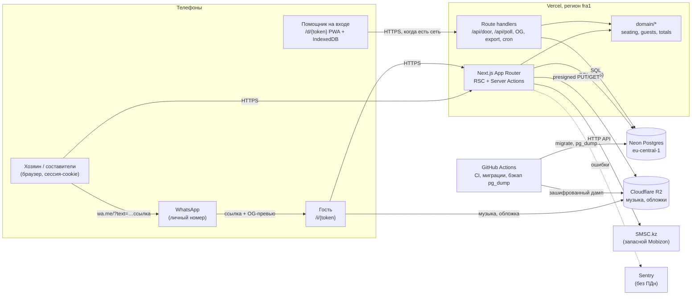

# Архитектура и план разработки: веб-продукт для тоя

Версия 1.7 · 2026-10-10 (решения основателя — раздел 0А и `docs/DECISIONS.md`; ревью дизайна — `docs/reviews/design-review.md`, ворота «Дизайн» **закрыты**; журнал изменений — раздел 20)
Основа: `HANDOVER_v2.md` (продуктовая спецификация, при расхождениях верна она), `design/design_spec.md` (сценарии, состояния, тексты, алгоритм рассадки), `prototype/index.html` (проверенная логика), `research/toi_pains_research.md` (рынок, закон № 94-V, цены WhatsApp).
Для кого: основатель (соло-разработчик) и ИИ-агенты, которые будут писать код по фазам.

Обозначения: **[ФАКТ]** проверено по источнику (ссылка в тексте или в разделе 19); **[ОЦЕНКА]** расчёт или суждение архитектора; **[ПРОВЕРИТЬ]** не удалось подтвердить, проверить до того, как на это опираться.

---

## 0. Коротко

| Вопрос | Решение |
|---|---|
| Фреймворк | **Next.js 15+/16, App Router** | Основатель силён в Next.js; Server Actions убирают слой REST для форм рабочих экранов; `standalone` запускается где угодно. **Исключение — страница гостя `/i/{token}`**: route handler отдаёт готовый HTML без React-рантайма (раздел 10), потому что любая страница App Router тянет ~90–110 КБ gzip JS фреймворка [ОЦЕНКА, замерить в Ф5] | Remix/React Router 7 (не хуже, но меньше опыта); Astro для гостевой страницы (лишний второй фреймворк) |
| База | Обычный PostgreSQL 16+. Пилот: **Neon** (регион Франкфурт). Коммерция: Postgres в Казахстане |
| ORM и миграции | **Drizzle ORM** + `drizzle-kit`, миграции в виде SQL-файлов в репозитории |
| Вход | **Своя реализация** (по руководству Lucia), без Supabase Auth. Составители входят **по одноразовой ссылке**, которую хозяин отправляет через WhatsApp (`wa.me`) — работает у всех операторов. **SMS-код** — запасной путь и повторный вход. Сессия 180 дней на устройстве |
| SMS | Вторичный канал входа. Основной **SMSC.kz**, запасной **Mobizon**. Код примерно **17–24 ₸** за SMS. Kcell/Activ и Tele2/Altel — с общего имени отправителя; Beeline требует платное имя (~17 500 ₸/мес), на пилоте не берём: Beeline-пользователи входят только по ссылке |
| Где SMS не нужен | Приглашения, напоминания, номер стола — только `wa.me` с личного телефона (бесплатно, вызывает доверие). SMS только для кодов входа |
| Файлы (музыка, обложки) | **Cloudflare R2** (S3 API) на пилоте → объектное хранилище S3 в KZ |
| Хостинг и домен | Пилот: **Vercel** (функции во `fra1`, рядом с базой), домен Vercel `*.vercel.app` (рабочее название «Той», свой домен не покупаем). Коммерция: VM в KZ (Docker: Next.js standalone + Caddy) и свой домен |
| UI | **Tailwind CSS v4** + компоненты в стиле **shadcn/ui** (Radix, код лежит в репо, полностью перекрашивается под новый дизайн), шторки **Vaul**, тосты **Sonner** |
| i18n | **next-intl** без префикса языка в URL (язык в cookie), kk по умолчанию, ru второй |
| Схема зала | Свой SVG-компонент на React по геометрии из `design_spec` 3.12–3.13, без библиотек |
| Помощник на входе | PWA только на маршруте `/d/*`: **Serwist** (service worker) + **IndexedDB** (`idb`), очередь отметок с идемпотентной синхронизацией |
| Рассадка | Чистый TypeScript-модуль `domain/seating`; авторитетно выполняется на сервере в транзакции; **инкрементальная**: рассаженных не двигает |
| Совместная работа | Блокировка события в транзакции (`SELECT … FOR UPDATE`), версия рассадки, опрос версии раз в 15 с вместо websocket |
| Экспорт | Excel: `exceljs`; PDF: страница для печати (A4, CSS print) → «Сохранить как PDF» |
| OG-картинки | `next/og` (`ImageResponse`), шрифт с казахскими буквами вшит |
| Ошибки и метрики | Sentry (без персональных данных), собственная таблица `activity_log` для воронки пилота |
| Стоимость пилота | **≈ 0–20 $/мес** + SMS на копейки (≈ 200–500 ₸ за весь пилот) |
| Стоимость при ~100 событиях/мес в KZ | **≈ 85–130 тыс. ₸/мес**, из них ~53 тыс. ₸ фиксированная плата за имена отправителя SMS |
| Сроки | Старт 12.10.2026 → дизайн-ворота 29.10 → релиз A (гости, приглашения) **09.12.2026** → релиз B (рассадка) **21.12.2026** → релиз C (номер стола, помощник) **28.12.2026** → заморозка кода **15.01.2027** → пилот, окно **23.01–13.02.2027** (цель 30.01). Подробно: раздел 12 |

Четыре важных уточнения к спецификации (подробности ниже):
1. **Смена порядка категорий больше не пересаживает людей автоматически** (следствие решения от 2026-10-09 «рассаженных не трогаем»). Новый порядок действует для новых гостей; чтобы применить его ко всем, есть кнопка «Толық қайта отырғызу» с предпросмотром. Экран H5 в `design_spec` надо поправить.
2. **Supabase из стека убран** (в handover он был). Причина: переезд в Казахстан. Supabase Auth и Storage пришлось бы переписывать; обычный Postgres + своя авторизация + S3 переносятся за день.
3. **Домен `.kz` на Vercel невозможен**: правила зоны .kz требуют сервер в Казахстане с казахстанским IP [ФАКТ, travelpayouts/nic.kz]. На пилоте используем домен Vercel (решение Р7), `.kz` — только после переезда в KZ.
4. **Пилот теперь на чужой свадьбе** (решение Р1). Исключение «для личных и семейных нужд» основателю как поставщику сервиса больше не подходит; см. раздел 4.2 и открытый вопрос Р10.

---

## 0А. Решения основателя 2026-10-09

Ответы на вопросы Р1–Р9 версии 1.0. Ниже — что решено и где это отражено в плане.

| № | Решение | Что изменилось в плане |
|---|---|---|
| Р1 | Своя свадьба (18.10.2026) слишком близко. Пилот — свадьба другой семьи, которую найдёт основатель. Окно тоя **23.01–13.02.2027**, цель **30.01.2027**. Старт разработки **12.10.2026** | Новый календарь с датами, волнами релизов, праздниками и буфером (12.1–12.2); дизайн делается до UI (раздел 13); правовой статус пилота пересмотрен (4.2, открытый вопрос Р10); новые риски (16) |
| Р2 | Принято: Neon + своя авторизация вместо Supabase | Без изменений (2, 2.1) |
| Р3 | Принято: гость с выросшим числом мест остаётся на месте, предупреждение + перенос одним нажатием | 7.2, Ф7b |
| Р4 | Принято: смена порядка категорий не пересаживает; полная пересадка только кнопкой | 7.2, Ф7b, 13.4 |
| Р5 | Большинство окружения основателя на Activ (Kcell), но нужен способ для всех операторов. **Основной вход составителей — одноразовая ссылка через WhatsApp** (`wa.me` с телефона хозяина); **SMS-код (SMSC.kz) — запасной и повторный вход** | Потоки входа, срок ссылки, привязка к устройству, повторный вход, Beeline (6.1); таблицы `login_links`, `allowed_owners`, поля сессий (5); SMS стал вторичным (3.3–3.5); затраты на SMS ниже (15) |
| Р6 | Обложки приглашений — ИИ-генерация | Стек «Изображения» (2), бриф дизайнеру (13.3), Ф5 |
| Р7 | Рабочее название «Той». Домена нет, на пилоте домен Vercel | Хостинг (0, 1.3), WebOTP (3.6), стоимость (15), риск доверия к `*.vercel.app` (16) |
| Р8 | Принято: удаление гостей через 90 дней после тоя | Без изменений (4.2, 9) |
| Р9 | Расходы видят и меняют хозяин **и родители** | `member_kind`, `can_manage_budget`, `updated_by` (5); `requireBudget` и права по умолчанию (5.3); доступ к действиям (6.7); Ф9 |

Дополнительно основатель задал процесс работы агентов: архитектор → дизайнер → ревью дизайна → разработчик по одной фазе → ревью каждой фазы. Описан в разделе 13.

---

## 1. Архитектура

### 1.1 Пилот



### 1.2 Коммерческий запуск (всё с персональными данными в KZ)

```
             Телефоны (хозяева, составители, гости, помощники)
                                 │ HTTPS
                                 ▼
 ┌──────────────────────── Облако в Казахстане ───────────────────────────┐
 │  VM (2 vCPU / 4 GB):                                                   │
 │   Caddy (TLS, gzip/br) → Next.js standalone (Docker, Node 22)          │
 │   systemd timers: retention, backup, напоминания-счётчики              │
 │        │ SQL                         │ S3 API                          │
 │        ▼                             ▼                                 │
 │   Managed Postgres (или Postgres     Объектное хранилище S3            │
 │   на той же VM + pg_dump)            (музыка, обложки, бэкапы)         │
 └────────────────────────────────────────────────────────────────────────┘
        │ HTTPS API                              │ (только ошибки без ПДн)
        ▼                                        ▼
   SMSC.kz / Mobizon (KZ)                      Sentry
```

Принцип: код один и тот же. Отличаются только переменные окружения (`DATABASE_DRIVER=neon|pg`, `S3_ENDPOINT`, `SMS_PROVIDER`) и способ запуска (Vercel или Docker).

### 1.3 Ключевые маршруты

| Маршрут | Кто | Что |
|---|---|---|
| `/join/{loginToken}` | составитель (и хозяин пилота) | **основной вход**: одноразовая ссылка, которую хозяин отправляет через WhatsApp (раздел 6.1) |
| `/login` | все | запасной и повторный вход: телефон → SMS-код → сессия; если код не приходит — «Иесінен сілтеме сұрау» |
| `/e` | хозяин, составитель | мои события |
| `/e/{eventId}/guests` | составитель | «Менің тізімім», добавление, «Жауап бермегендер» |
| `/e/{eventId}/hall` | составитель | схема, стол, перенос, порядок, история |
| `/e/{eventId}/summary` | составитель | итоги, число для ресторана |
| `/e/{eventId}/budget` | хозяин и родители (`can_manage_budget`) | расходы (решение Р9) |
| `/e/{eventId}/settings` | хозяин | событие, шаблон, музыка, составители и их ссылки входа, устройства, ссылка помощника |
| `/e/{eventId}/print/tables` | составитель | список по столам для печати и PDF |
| `/i/{token}` | гость | конверт → приглашение → ответ; позже номер стола. **Route handler, не RSC-страница**: HTML собирается на сервере из TSX-шаблонов через `renderToStaticMarkup` (без гидратации) + встроенный ванильный JS ≤ 10 КБ; ответ отправляется обычной формой `POST /i/{token}` и работает даже до загрузки JS (раздел 10) |
| `/d/{doorToken}` | помощник | поиск, стол, «келді», офлайн |

---

## 2. Стек и обоснование

Одна рекомендация на каждый выбор; альтернативы кратко.

| Слой | Выбор | Почему | Альтернативы и почему нет |
|---|---|---|---|
| Фреймворк | **Next.js 15+/16, App Router** | Основатель силён в Next.js; RSC дают страницу гостя почти без JS; Server Actions убирают слой REST для форм; `standalone` запускается где угодно | Remix/React Router 7 (не хуже, но меньше опыта); Astro для гостевой страницы (лишний второй фреймворк) |
| Язык | TypeScript strict, zod для всех входов | Общие схемы для клиента и сервера | — |
| База | **PostgreSQL 16+** (пилот Neon) | Стандарт, есть в любом облаке KZ; данные реляционные и маленькие | Supabase (см. ниже); SQLite/Turso (сложнее с конкурентной записью и переездом в KZ) |
| Хостинг БД на пилоте | **Neon Free**, `aws-eu-central-1` | Бесплатно (1 ГБ, 100 CU-часов), ветки базы на каждый PR, PITR | Supabase Free (500 МБ, пауза после недели простоя) [ФАКТ supabase.com/pricing] |
| ORM | **Drizzle** | SQL-подобный, типобезопасный, миграции в SQL-файлах (их можно читать и прогонять где угодно), драйверы и для Neon serverless, и для `node-postgres` | Prisma (тяжелее движок, хуже для serverless и самостоятельной сборки); Kysely (хорош, но без генерации миграций) |
| Авторизация | **Своя**: одноразовые ссылки входа через WhatsApp (основной путь, решение Р5) + OTP по SMS (запасной) + таблица сессий (схема из руководства lucia-auth.com) | ~400 строк, полный контроль над текстами, лимитами и сроком сессии (месяцы); переносится вместе с базой | **Supabase Auth** (телефон + Send SMS Hook позволяет подключить любой SMS-шлюз [ФАКТ supabase docs], но привязка к GoTrue и `auth.users`, а вход по ссылке через WhatsApp всё равно пришлось бы писать самим); **Better Auth** с плагинами phoneNumber/magicLink (запасной вариант, если своя реализация затянется больше чем на 2 дня) |
| Авторизация данных | Проверки в серверном слое (`authz.ts`), RLS не используем | Клиент к базе напрямую не ходит; одна роль приложения; проще тестировать; не зависит от Supabase | RLS как вторая линия защиты можно добавить позже |
| i18n | **next-intl** без i18n-маршрутизации (язык в cookie `locale`, по умолчанию `kk`) | Короткие ссылки гостя `/i/{token}` без `/kk/`; ICU-плюрализация для ru; работает в RSC | `next-i18next` (под Pages Router), свой словарь как в прототипе (нет плюралов и типов) |
| Стили и UI | **Tailwind CSS v4** + **shadcn/ui** (Radix), **Vaul** для шторок, **Sonner** для тостов с «Қайтару» | Дизайн переделывается полностью: компоненты shadcn лежат в репозитории как свой код, токены в CSS-переменных; доступность из коробки (фокус в шторке, aria) | MUI/Chakra/Mantine (свой визуальный язык, сложно перекрасить, тяжелее бандл) |
| Шрифты | Рабочие экраны: `next/font/google` (**Onest** 400/600 + **Cormorant Garamond** 600, по дизайну v2), подмножества `cyrillic` + `cyrillic-ext`. Страница гостя: **свои woff2-подмножества** (`pyftsubset`: казахский и русский алфавит, цифры, «»—·–₸), Cormorant 600 + Onest 400, вместе ≤ 40 КБ | Казахские буквы лежат в `cyrillic-ext`; оба шрифта проверены дизайнером по `cmap` (18/18) | Manrope и Unbounded не годятся (нет казахских букв) |
| Анимации и декор | **CSS keyframes + инлайновый SVG** (орнамент «рисуется» `stroke-dashoffset`, мягкое движение, параллакс по скроллу через `animation-timeline` где поддерживается); в рабочих экранах — **Motion** (`motion/react`, `LazyMotion` + `domAnimation`, ~15 КБ) только для шторок, списков и перестановок; везде `prefers-reduced-motion` | Дизайнер просит адаптивные анимированные декоративные элементы вместо статичных картинок; CSS/SVG почти ничего не весят и масштабируются от телефона до компьютера | Lottie (плеер ~50–60 КБ gzip — не помещается в бюджет страницы гостя); видео-фон (тяжело на слабом интернете); Canvas/WebGL (батарея, доступность) |
| Схема зала | **Свой SVG-компонент** (React, `viewBox`, `width:100%`) | Геометрия уже точно описана (3.12–3.13); 20 столов × 16 стульев = ~350 элементов, без проблем; без жестов и зума по решению UX | Konva/Canvas (не нужны, хуже доступность); react-zoom-pan-pinch (зум запрещён спецификацией) |
| Офлайн-помощник | **Serwist** (`@serwist/next`), scope `/d/`; **idb** для IndexedDB | Serwist — поддерживаемый преемник next-pwa; SW только для страницы помощника, остальной сайт без SW (меньше сюрпризов с кэшем) | Workbox вручную (больше кода); Dexie (тяжелее, не нужен) |
| Файлы | **Cloudflare R2** → S3 в KZ | S3 API (переезд = смена endpoint), нет платы за исходящий трафик, 10 ГБ бесплатно | Vercel Blob (привязка к Vercel); Supabase Storage |
| Загрузка | Presigned PUT прямо из браузера в R2 | Обходит лимит тела запроса функций Vercel (~4,5 МБ) | Загрузка через сервер |
| Обработка музыки | `ffmpeg-static` в Node-функции: обрезка до 90 с, MP3 96 кбит/с, плавное затухание → ~1,1 МБ | Handover требует ~1 МБ; MP3 играет везде | [ПРОВЕРИТЬ] размер функции на Vercel (бинарь ~70 МБ при лимите 250 МБ). Запасной путь: принимать только файлы ≤ 3 МБ без обработки |
| Изображения | Обложки шаблонов — **ИИ-генерация** (решение Р6), затем ручной отбор и сжатие в AVIF/WebP скриптом `sharp` при сборке (≤ 60 КБ на мобильный размер); фото пользователя (позже) режем `sharp` при загрузке на 2 размера | Не зависит от Vercel Image Optimization, одинаково работает в KZ | `next/image` с оптимизатором Vercel (лимиты Hobby, привязка) |
| OG-картинки | **`next/og` `ImageResponse`** на `/i/{token}/opengraph-image`, 1200×630 PNG, шрифт TTF с казахскими буквами | Персональная карточка «Ерлан ағай, сізді тойға шақырамыз»; работает и на Node в Docker | Заранее сгенерированные картинки (не персональные) |
| Excel | **exceljs** | Листы «Столы» и «Гости», кириллица без проблем | SheetJS CE (ок, но версия с CDN) |
| PDF | **Страница печати** `/print/tables` + CSS `@page A4` → «Сохранить как PDF» в телефоне/ПК | Ноль зависимостей, шрифты браузера, казахские буквы гарантированы | `@react-pdf/renderer` (добавить, если нужна кнопка «скачать PDF» одним нажатием) |
| Графики расходов | Обычные `div`-полосы на Tailwind | Handover: горизонтальные полосы, без круговой; библиотека не нужна | Recharts (лишние ~100 КБ) |
| Ошибки | **Sentry** (Developer, бесплатно), `sendDefaultPii: false`, `beforeSend` маскирует телефоны и имена | Нужен один инструмент; ПДн не уходят за рубеж | Highlight, GlitchTip (самостоятельно в KZ при коммерции, если юрист попросит) |
| Аналитика | **Своя таблица `activity_log`** (открыл ссылку, открыл конверт, ответил, нажал «WhatsApp», «келді») | Это и есть метрики успеха пилота (раздел 15 handover); без сторонних скриптов на странице гостя | Vercel Analytics/Umami — позже для маркетингового сайта |
| Email | Нет | Решение основателя: продукт без почты | — |
| Тесты | **Vitest** + **fast-check** (рассадка), **Playwright** (e2e, мобильный вьюпорт 360×740) | Стандарт; property-тесты ловят ошибки в инвариантах рассадки | Jest (медленнее) |
| Менеджер пакетов | pnpm | — | — |

### 2.1 Почему не Supabase (сравнение для входа по телефону)

| Критерий | Supabase (Postgres + Auth + Storage) | Neon + своя авторизация + R2 |
|---|---|---|
| Вход по SMS через KZ-шлюз | Да, через Send SMS Hook [ФАКТ] | Да, прямой вызов API шлюза |
| Время на авторизацию | ~0,5 дня | ~1,5–2 дня с ИИ-агентом |
| Переезд в KZ | Самостоятельный хостинг Supabase (Docker, ~10 сервисов) или переписывание Auth/Storage | `pg_dump` → `pg_restore`, `rclone` файлов, смена env |
| Сессия на месяцы | Настраивается, но через refresh-токены и их логику | Просто `expires_at` с продлением |
| Бесплатный тариф | 500 МБ, пауза после недели простоя | 1 ГБ, засыпание через 5 мин (холодный старт) |
| Вывод | Быстрее старт, дороже переезд | **Выбран**: чуть дольше старт, дешёвый переезд |

---

## 3. SMS для Казахстана

### 3.1 Что известно о рынке

- **[ФАКТ]** В KZ операторы делят SMS на национальные (транзакционные, сервисные, рекламные) и международные; для международных нужно индивидуальное имя отправителя, регистрация 15–30 дней (smsc.kz/tariffs).
- **[ФАКТ]** Общие (бесплатные) имена отправителя есть у **Kcell** (`SMSC.KZ`, `INFORM`) и **Tele2/Altel** (`InfoSMS`). **У Beeline общего имени нет**: нужна абонентская плата за своё имя (SMSC.kz: 17 500 ₸/мес; Mobizon: «SMS абонентам Beeline возможна только по Тарифному плану 2», 17 400 ₸/мес) (smsc.kz/tariffs, mobizon.kz/prices).
- **[ФАКТ]** Абонентская плата за своё имя у SMSC.kz: Kcell 14 500 ₸, Beeline 17 500 ₸, Tele2/Altel 20 800 ₸ в месяц, регистрация национального имени бесплатна. У Mobizon: Kcell 14 500, Beeline 17 400, Altel/Tele2 20 800 ₸/мес, регистрация до 30 дней.
- **[ФАКТ]** Доля операторов примерно: Beeline ~35 %, Kcell ~35 %, Tele2/Altel ~30 % (sent.dm). Значит, без имени у Beeline примерно каждый третий составитель не получит код.
- **[ФАКТ]** Международные шлюзы дорогие: Twilio $0,3382 за SMS в KZ (twilio.com/en-us/sms/pricing/kz), Infobip ~$0,20, Sinch ~$0,24 (sent.dm). И для них тоже нужна регистрация имени.
- **[ПРОВЕРИТЬ]** Для регистрации своего имени отправителя оператору обычно нужны документы юрлица или ИП (заявка на бланке, БИН). Для коммерческого запуска ИП/ТОО всё равно понадобится.

### 3.2 Цены за SMS (с НДС, в тенге, на 2026-10-09)

| Провайдер | Kcell | Beeline | Tele2/Altel | Своё имя, ₸/мес | Мин. платёж | Источник |
|---|---|---|---|---|---|---|
| **SMSC.kz** | 17,60 (своё имя) / 19,60 (общее имя) | 19,70 (только своё имя) | сервисные 17,60; общее имя 23,50; транзакц. 12,10 | 14 500 / 17 500 / 20 800 | от 1 ₸, предоплата | smsc.kz/tariffs |
| **Mobizon** | 16,60 | только тариф 2 | 19,60 (рекл.); верификационные 10,40 по зарегистрированному шаблону | 14 500 / 17 400 / 20 800 | бонус 100 ₸, предоплата | mobizon.kz/prices |
| Twilio | ≈ 176 ₸ ($0,3382) | — | — | + регистрация | — | twilio.com |
| Infobip | ≈ 105 ₸ ($0,203) | — | — | + регистрация | — | sent.dm |

Курс для пересчёта: 1 $ ≈ 520 ₸ [ОЦЕНКА, проверить на дату оплаты].

Дополнительно у SMSC.kz [ФАКТ, smsc.kz/tariffs]: **коды в Telegram 12 ₸** («к отправке в Telegram допускаются только сообщения с кодами подтверждения»), WhatsApp «Услуги, аутентификация» 15,10 ₸ для KZ, голосовой звонок с кодом запрещён.

### 3.3 Рекомендация

После решения Р5 SMS — **вторичный** канал входа (основной — одноразовая ссылка через WhatsApp, раздел 6.1). Поэтому объём SMS маленький, а выбор провайдера менее критичен.

- **Основной SMS-провайдер: SMSC.kz.** Предоплата от 1 ₸ (пилот без вложений), общие имена у Kcell и Tele2/Altel (на пилоте не нужно ждать регистрации), простой HTTP API (`/sys/send.php`, ответ в JSON при `fmt=3`, статусы доставки через `/sys/status.php` или callback), есть запасные каналы (Telegram-код 12 ₸, WhatsApp-аутентификация) у того же провайдера. Компания работает с KZ давно, бесплатная линия 8 800 080 7672.
- **Запасной: Mobizon** (KZ, REST API с `apiKey`, OTP/2FA заявлены, тариф «верификационные» 10,40 ₸ после регистрации шаблона). Подключается вторым классом `SmsProvider`; используется при ошибке основного или по кнопке «Код келмеді, қайта жіберу» через 60 с.
- **Не брать** Twilio/Infobip: в 6–10 раз дороже, регистрация имени всё равно нужна.
- **[ПРОВЕРИТЬ в Ф0]** Реальная доставка: отправить коды на номера Kcell/Activ, Beeline, Tele2, Altel у обоих провайдеров, замерить время. Доставка на Beeline с общим именем ожидаемо не пройдёт. Большинство окружения основателя на Activ (бренд Kcell) — для них общее имя `SMSC.KZ`/`INFORM` подходит.

### 3.4 Как это работает на пилоте и после

| Этап | Kcell, Tele2, Altel | Beeline | Фикс. плата |
|---|---|---|---|
| **Пилот** | Основной: ссылка через WhatsApp. Повторный вход: SMS-код с общего имени SMSC.kz | Только ссылка через WhatsApp (SMS не уходит; экран входа сразу предлагает «Иесінен сілтеме сұрау»). Запасной вариант на будущее: код в Telegram через SMSC (12 ₸) | 0 ₸ |
| **Коммерция** | Своё имя у всех трёх операторов, шаблон кода зарегистрирован как сервисный/верификационный | То же | ≈ 52 800 ₸/мес |
| **Позже** | Код в WhatsApp (шаблон «аутентификация», ~15 ₸) после верификации в Meta | То же | 0 + верификация |

Ссылка одинаково работает у всех операторов и ничего не стоит: хозяин добавляет «Анасы» и сразу жмёт «WhatsApp-қа жіберу», мама нажимает ссылку, затем «Кіру», и она внутри. SMS-код нужен, когда сессия потеряна (новый телефон, очищен браузер), а хозяин недоступен.

### 3.5 Где SMS стоит своих денег, а где нет

| Сообщение | Канал | Почему |
|---|---|---|
| Ссылка входа составителя | `wa.me` с телефона хозяина | Бесплатно, у всех операторов; хозяин знает этих людей лично |
| Код повторного входа | **SMS** | Независимый канал, подтверждающий номер, когда хозяина рядом нет |
| Приглашение гостю | `wa.me` | Бесплатно; приходит от знакомого номера (SMS с буквенного имени со ссылкой выглядит как мошенничество и может попасть в «рекламные»); в WhatsApp видна OG-карточка |
| Напоминание «Жауап бермегендер» | `wa.me` | То же |
| Номер стола за 1–2 дня | `wa.me` очередью | То же; 100–150 семей × 20 ₸ = 2–3 тыс. ₸ за рассылку, которую можно сделать бесплатно |
| Уведомления хозяину («5 новых ответов») | Внутри приложения | Не срочно; SMS тратит деньги и раздражает |
| Гостям без WhatsApp (кнопочный телефон) | **Позже, платная опция** SMS «Шақыру» | Как каскад у Invitation.az [ФАКТ, исследование]; только если пилот покажет такую потребность |

### 3.6 Интеграция

- Интерфейс `SmsProvider { send(to: E164, text): Promise<{providerMsgId, status, cost}>; status(providerMsgId, to): Promise<SmsStatus> }` (телефон в `status` нужен SMSC.kz; ревью Ф0); реализации `SmscKz`, `Mobizon`, `Console` (dev/preview: код пишется в лог и показывается на экране только при `SMS_PROVIDER=console`).
- Текст кода ≤ 70 символов (кириллица идёт в UCS-2, 70 символов = 1 сегмент), последняя строка для WebOTP на Android:
  `Той: кіру коды 482913. Ешкімге айтпаңыз.`
  `@toi-pilot.vercel.app #482913` (домен пилота; WebOTP требует точное совпадение домена). Финальные тексты — ключ `sms.otp` в `content/messages/*.json`. **Домен не длиннее 20 символов** (имя проекта Vercel ≤ 9 символов), иначе kk-текст уйдёт двумя SMS
  Поле ввода `autocomplete="one-time-code" inputmode="numeric"`.
- Таблица `sms_log` (маскированный номер, хэш номера, провайдер, id, статус, стоимость) для учёта денег и разбора «код не пришёл».
- Глобальный дневной лимит на отправку (например, 300 SMS/сутки) и оповещение в Sentry при 80 % — защита от «накачки» SMS (SMS pumping).

---

## 4. Персональные данные и размещение в Казахстане

### 4.1 Правовая рамка (кратко)

- **[ФАКТ]** Закон РК № 94-V, ст. 12 п. 2: хранение персональных данных «в базе, находящейся на территории Республики Казахстан»; ст. 16: трансграничная передача может быть ограничена; ст. 3: закон не применяется к обработке «исключительно для личных и семейных нужд, если не нарушаются права других»; ст. 7–8: согласие (adilet.zan.kz, prg.kz).
- **[ФАКТ]** Штрафы с марта 2025: до 2 000 МРП; об утечке сообщать за 1 рабочий день (обзоры в исследовании).
- **[ФАКТ]** Домены `.kz`/`.қаз`: сервер в дата-центре KZ, казахстанский IP, A/AAAA/CNAME на казахстанские адреса; нарушителей приостанавливают (nic.kz, travelpayouts 2021).
- **[ПРОВЕРИТЬ у юриста]** Считается ли хранением «вне KZ» обработка в функциях Vercel за рубежом, если сама база в KZ. Архитектор исходит из строгого прочтения: **всё, что видит ПДн (сервер приложения, база, файлы, бэкапы, логи), — в KZ**.

### 4.2 Пилот

- **Изменение (решение Р1):** пилот — свадьба другой семьи, которую найдёт основатель. Сама семья обрабатывает данные своих гостей «для личных и семейных нужд» (ст. 3), но основатель хранит эти данные на своём сервисе для третьих лиц и, скорее всего, становится **оператором**. Тогда действует ст. 12 п. 2 (хранение в KZ) даже для бесплатного пилота. **[ПРОВЕРИТЬ у юриста до 13.11.2026]** — открытый вопрос Р10.
- План по умолчанию (по решению Р7): Vercel `fra1` + Neon `eu-central-1` + R2, домен `*.vercel.app`; письменное согласие семьи-пилота на участие и на то, что сервис тестовый; минимум данных.
- Запасной план, если юрист скажет «нужно в KZ»: условный слот **Ф-KZ (3–4 дня)** перед релизом A — продакшен сразу на VM в KZ (раздел 4.5 в сокращённом виде: VM + Postgres на ней + бэкапы в объектное хранилище KZ). Для KZ-хостинга понадобится свой домен (`.com` ≈ $12/год или `.kz`), домен Vercel там недоступен. Preview-окружения остаются на Vercel только с демо-данными. Инфраструктуру основатель поднимает параллельно с Ф5–Ф6, поэтому релиз A сдвигается максимум до ≈ 11–12.12.2026 — на границе требования «за 6 недель до тоя» (раздел 12.2).
- Минимизация с первого дня: телефон гостя необязателен; помощнику на входе телефоны не отдаются; в Sentry и логи ПДн не пишутся; через 90 дней после события данные гостей удаляются (cron), расходы и агрегаты остаются.

### 4.3 Коммерческий запуск: куда и как

Кандидаты (все с дата-центрами в KZ):

| Провайдер | Что есть | Цена | Оценка |
|---|---|---|---|
| **Yandex Cloud, регион `kz1`** (зона `kz1-a`) | Compute, Managed PostgreSQL (цены в тенге для региона KZ), Object Storage [ПРОВЕРИТЬ наличие Object Storage в kz1] | цены в калькуляторе; в примере документации vCPU-час ≈ 13,5 ₸ [ФАКТ yandex.cloud/ru-kz/docs/managed-postgresql/pricing] | **Рекомендация по умолчанию**: managed Postgres с бэкапами, Terraform, понятная документация |
| **PS Cloud (ps.kz)** | VPS/облачные серверы, объектное хранилище, managed Kubernetes, облачные БД, бэкапы; работает с 2003 г. | VPS KVM-1 (1 vCPU, 1 ГБ, 15 ГБ) ≈ 2 383 ₸/мес [ФАКТ whtop.com, дата не указана] | **Запасной**: местная компания, договор и счёт в тенге |
| Hoster.kz | VPS | VDS-SSD-1 (1 vCPU, 1 ГБ, 20 ГБ) ≈ 2 400 ₸/мес [ФАКТ whtop.com] | Для дешёвой VM, без managed БД |
| QazCloud (Казахтелеком) | Гос./корпоративное облако | по запросу | Избыточно для старта |

Целевая конфигурация [ОЦЕНКА]: 1 VM 2 vCPU / 4 ГБ (Next.js + Caddy в Docker), managed Postgres минимального класса (или Postgres на той же VM с ежедневным `pg_dump` в объектное хранилище), объектное хранилище S3 для музыки/обложек/бэкапов. 100 событий в месяц — это десятки запросов в минуту в пике, одна VM справляется с большим запасом.

### 4.4 Что делаем сейчас, чтобы переезд стоил дёшево

1. Только **обычный Postgres**: никаких `auth.*`, `storage.*`, Supabase/Neon-специфичных расширений. Расширения только из стандартной поставки (`pgcrypto`, `pg_trgm`).
2. Доступ к базе через один модуль `server/db.ts`; драйвер выбирается переменной: `@neondatabase/serverless` на Vercel, `pg` в Docker. Drizzle поддерживает оба.
3. Файлы только через **S3 API** (`@aws-sdk/client-s3`, presigned URL); endpoint и bucket из env.
4. Не использовать Vercel KV, Blob, Edge Config, Vercel Postgres; не писать код, работающий только в Edge runtime. `next/og` вместо `@vercel/og`.
5. Ограничение частоты (rate limit) хранится **в Postgres**, а не в Upstash/Redis.
6. Фоновые задачи — обычные route handlers с секретом (`/api/cron/*`); на Vercel их дергает Vercel Cron, в KZ — `systemd timer` + `curl`.
7. `next.config`: `output: "standalone"`; Dockerfile лежит в репозитории с первого дня и собирается в CI (даже если не деплоится).
8. Часовой пояс событий хранится явно (`Asia/Almaty`), время в базе `timestamptz`.

### 4.5 План переезда (runbook, ~4–6 дней)

1. Юрлицо/ИП, договор с облаком KZ, политика конфиденциальности, оферта, текст согласия гостя (с юристом).
2. Terraform или ручное создание: VM, managed Postgres, bucket, DNS. Домен `.kz` (если нужен) только теперь.
3. CI: сборка Docker-образа → registry провайдера → `docker compose pull && up -d` по SSH (GitHub Actions).
4. Режим «только чтение» на старом проде (флаг `MAINTENANCE=1`, баннер), `pg_dump -Fc` из Neon → `pg_restore` в KZ; `rclone sync r2:bucket kz:bucket`.
5. Переключить DNS (TTL заранее 300 с), смоук-тесты Playwright против нового адреса.
6. Включить cron (retention, бэкапы), проверить восстановление из бэкапа.
7. Удалить данные из Neon и R2, записать дату удаления (журнал для юриста).
Простой ≈ 30 минут. Старые ссылки гостей продолжают работать, если домен тот же; если меняется домен (на `.kz`), старый домен оставить с 301-редиректом на 6–12 месяцев.

---

## 5. Модель данных (PostgreSQL)

Отличия от ориентира в handover: вход по одноразовым ссылкам (`login_links`), тип составителя и право на расходы (`member_kind`, `can_manage_budget`); статусы гостя вычисляются из `rsvp` + `sent_at`; столы хранятся в `hall_tables` с составным ключом (номер стола), чтобы смена зала не ломала ссылки; добавлены сессии, OTP, приглашения составителей, проверенные пары дублей, журнал активности, медиа, отметки помощника.

Деньги в целых тенге (`bigint`), время `timestamptz`, телефоны в E.164 (`+77XXXXXXXXX`).

```sql
create extension if not exists pgcrypto;

create type locale         as enum ('kk','ru');
create type event_kind     as enum ('kyz_uzatu','uilenu_toi','sundet','besik','merey','other');
create type member_role    as enum ('owner','editor');
create type member_kind    as enum ('parent','couple','other');   -- әке/ана, жастар, басқа
create type rsvp_status    as enum ('pending','yes','no');
create type answer_source  as enum ('guest','member');
create type seating_action as enum ('auto_place','move','unlock','reorder','hall','full_reseat',
                                    'unseat','answer','undo');
create type media_kind     as enum ('music','cover');
create type media_status   as enum ('uploaded','processing','ready','failed');

-- Пользователи (хозяева и составители)
create table users (
  id            uuid primary key default gen_random_uuid(),
  phone         text not null unique check (phone ~ '^\+7\d{10}$'),
  name          text check (length(name) <= 60),
  locale        locale not null default 'kk',
  created_at    timestamptz not null default now(),
  last_login_at timestamptz
);

create table sessions (
  id           text primary key,                 -- sha256(token) hex; сам токен только в cookie
  user_id      uuid not null references users(id) on delete cascade,
  created_at   timestamptz not null default now(),
  expires_at   timestamptz not null,             -- +180 дней, продлевается при активности
  last_seen_at timestamptz not null default now(),
  auth_method  text not null check (auth_method in ('link','sms')),
  device_label text,                             -- «Android · Chrome», из User-Agent, для хозяина
  user_agent   text,
  revoked_at   timestamptz,
  scope        text not null default 'all'        -- 'all' (SMS, ссылка основателя) | 'events' (ссылка составителя), v1.5
               check (scope in ('all','events'))
);
create index sessions_user_idx on sessions(user_id) where revoked_at is null;

create table session_events (                     -- события, доступные сессии со scope = 'events' (v1.5)
  session_id text not null references sessions(id) on delete cascade,
  event_id   uuid not null references events(id) on delete cascade,
  primary key (session_id, event_id)
);

create table otp_challenges (
  id          uuid primary key default gen_random_uuid(),
  phone       text not null,
  code_hash   text not null,                     -- HMAC-SHA256(secret, phone||code)
  created_at  timestamptz not null default now(),
  expires_at  timestamptz not null,              -- +5 минут
  attempts    smallint not null default 0 check (attempts <= 5),
  consumed_at timestamptz,
  ip          inet,
  provider    text not null,                      -- 'none' для неизвестного номера (SMS не отправлялась)
  provider_msg_id text                           -- для otpDeliveryStatus (ревью Ф2)
);
create index otp_phone_idx on otp_challenges(phone, created_at desc);

create table rate_limits (
  key          text not null,                    -- 'otp:phone:+7701…', 'otp:ip:1.2.3.4', 'guest404:ip:…'
  window_start timestamptz not null,
  count        integer not null default 0,
  primary key (key, window_start)
);

create table media_assets (
  id          uuid primary key default gen_random_uuid(),
  event_id    uuid,                              -- FK ниже (циклическая ссылка с events)
  kind        media_kind not null,
  storage_key text not null unique,
  mime        text not null,
  bytes       integer not null check (bytes > 0 and bytes <= 20000000),
  duration_s  smallint,
  status      media_status not null default 'uploaded',
  created_at  timestamptz not null default now()
);

create table events (
  id                 uuid primary key default gen_random_uuid(),
  owner_id           uuid not null references users(id),
  kind               event_kind not null,
  title              text not null check (length(title) between 1 and 120),
  hosts_line         text check (length(hosts_line) <= 120), -- «Ұлымыз Айбек пен келініміз Дана»
  starts_on          date not null,
  starts_at          time,
  tz                 text not null default 'Asia/Almaty',
  venue_name         text, venue_address text, map_url text check (map_url ~ '^https://'),
  invitation_text_kk text check (length(invitation_text_kk) <= 2000),
  invitation_text_ru text check (length(invitation_text_ru) <= 2000),
  default_locale     locale not null default 'kk',
  template_id        text not null default 'classic',     -- шаблоны живут в коде
  cover_asset_id     uuid references media_assets(id) on delete set null,
  music_asset_id     uuid references media_assets(id) on delete set null,
  hall_columns       smallint check (hall_columns in (2,4)),
  tables_count       smallint check (tables_count between 1 and 60),
  seats_per_table    smallint not null default 12 check (seats_per_table between 6 and 16),
  price_per_seat     bigint check (price_per_seat >= 0),
  budget_total       bigint check (budget_total >= 0),
  door_token         text not null unique,
  rsvp_closes_at     timestamptz,                         -- по умолчанию начало дня тоя
  seating_version    integer not null default 0,          -- растёт при любом изменении рассадки
  version            integer not null default 0,          -- оптимистичная блокировка настроек
  created_at         timestamptz not null default now(),
  updated_at         timestamptz not null default now(),
  deleted_at         timestamptz,
  purge_after        date                                 -- starts_on + 90 дней
);
alter table media_assets add constraint media_event_fk
  foreign key (event_id) references events(id) on delete cascade;

create table categories (
  id           uuid primary key default gen_random_uuid(),
  event_id     uuid not null references events(id) on delete cascade,
  code         text,                               -- 'kuda','oz','nagashy',… у стандартных
  label_kk     text not null check (length(label_kk) between 1 and 40),
  label_ru     text check (length(label_ru) <= 40),
  seating_rank smallint not null,                  -- 1 = ближе всего к төру
  is_custom    boolean not null default false,
  color_token  text not null default 'cat-8',
  unique (event_id, seating_rank) deferrable initially deferred,
  unique (event_id, label_kk)
);

create table event_members (
  id                  uuid primary key default gen_random_uuid(),
  event_id            uuid not null references events(id) on delete cascade,
  user_id             uuid references users(id),            -- null, пока человек не вошёл
  phone               text not null check (phone ~ '^\+7\d{10}$'),
  role                member_role not null default 'editor',
  can_edit_seating    boolean not null default false,       -- «Тек тізім» / «Тізім + отырғызу»
  label               text not null check (length(label) <= 30),  -- «Әкесі», «Анасы», «Жастар»
  member_kind         member_kind not null default 'other',
  can_manage_budget   boolean not null default false,       -- расходы; по умолчанию true у parent (Р9)
  default_category_id uuid references categories(id) on delete set null,
  invited_at          timestamptz not null default now(),
  joined_at           timestamptz,
  removed_at          timestamptz,
  unique (event_id, phone)
);
create unique index one_owner_per_event on event_members(event_id) where role = 'owner';
create index members_user_idx on event_members(user_id) where removed_at is null;

create table login_links (                       -- основной вход составителей (Р5)
  token_hash      text primary key,                -- sha256 от токена в ссылке /join/{token}
  phone           text not null check (phone ~ '^\+7\d{10}$'),
  member_id       uuid references event_members(id) on delete cascade, -- null у ссылки хозяина пилота
  purpose         text not null check (purpose in ('member','owner_bootstrap')),
  created_by      uuid references users(id),       -- хозяин; null, если выдал скрипт основателя
  created_at      timestamptz not null default now(),
  expires_at      timestamptz not null,            -- +72 часа
  used_at         timestamptz,
  used_session_id text references sessions(id) on delete set null,
  revoked_at      timestamptz                      -- новая ссылка отзывает старые неиспользованные
);
create index login_links_member_idx on login_links(member_id) where used_at is null and revoked_at is null;

create table allowed_owners (                      -- пилот: кто может создавать события
  phone      text primary key check (phone ~ '^\+7\d{10}$'),
  note       text,
  created_at timestamptz not null default now()
);

create table hall_tables (
  event_id uuid not null references events(id) on delete cascade,
  no       smallint not null check (no >= 1),      -- номер, который видят люди
  capacity smallint not null check (capacity between 1 and 20),
  primary key (event_id, no)
);
-- уровень, колонна и порядок близости к төру вычисляются в domain/seating из no и hall_columns

create table families (
  id                    uuid primary key default gen_random_uuid(),
  event_id              uuid not null references events(id) on delete cascade,
  added_by_member_id    uuid not null references event_members(id),
  name                  text not null check (length(name) between 1 and 80),
  phone                 text check (phone ~ '^\+7\d{10}$'),
  category_id           uuid not null references categories(id),
  expected_count        smallint not null check (expected_count between 1 and 20),   -- лимит 20 (решение Д4/13)
  rsvp                  rsvp_status not null default 'pending',
  confirmed_count       smallint check (confirmed_count between 1 and 20),
  responded_at          timestamptz,
  answered_by           answer_source,
  answered_by_member_id uuid references event_members(id),
  table_no              smallint,
  seat_locked           boolean not null default false,     -- поставлен вручную
  locked_by_member_id   uuid references event_members(id),
  seat_seq              integer not null default 0,         -- порядок семей за столом
  token                 text not null unique,               -- ссылка гостя /i/{token}
  sent_at               timestamptz,
  reminded_at           timestamptz,
  table_sent_at         timestamptz,
  first_opened_at       timestamptz,
  arrived_at            timestamptz,
  rsvp_consent_at       timestamptz,                        -- галочка согласия (коммерция)
  version               integer not null default 0,
  created_at            timestamptz not null default now(),
  updated_at            timestamptz not null default now(),
  deleted_at            timestamptz,                        -- мягкое удаление для «Қайтару»
  foreign key (event_id, table_no) references hall_tables(event_id, no)
    on delete set null (table_no),                          -- PG15+
  check (rsvp <> 'yes' or confirmed_count is not null),
  check (table_no is not null or seat_locked = false)
);
create unique index families_phone_uniq on families(event_id, phone)
  where phone is not null and deleted_at is null;
create index families_event_idx  on families(event_id) where deleted_at is null;
create index families_table_idx  on families(event_id, table_no) where deleted_at is null;
create index families_member_idx on families(event_id, added_by_member_id) where deleted_at is null;

create table duplicate_reviews (                   -- «Екеуі де қалсын»
  event_id   uuid not null references events(id) on delete cascade,
  family_a   uuid not null references families(id) on delete cascade,
  family_b   uuid not null references families(id) on delete cascade,
  decided_by uuid not null references event_members(id),
  decided_at timestamptz not null default now(),
  primary key (event_id, family_a, family_b),
  check (family_a < family_b)
);

create table seating_changes (                     -- история и отмена
  id                    bigserial primary key,
  event_id              uuid not null references events(id) on delete cascade,
  actor_kind            text not null check (actor_kind in ('member','guest','system')),
  actor_member_id       uuid references event_members(id),
  action                seating_action not null,
  summary               jsonb not null,  -- для текста истории: имена, from/to, категория, размеры
  diff                  jsonb not null,  -- см. 5.2
  seating_version_after integer not null,
  revert_of             bigint references seating_changes(id),
  reverted_by           bigint references seating_changes(id),
  created_at            timestamptz not null default now()
);
create index seating_changes_event_idx on seating_changes(event_id, created_at desc);

create table expenses (
  id             uuid primary key default gen_random_uuid(),
  event_id       uuid not null references events(id) on delete cascade,
  category       text not null check (category in
                   ('restaurant','asaba','clothes','gifts','decor','photo','transport','other')),
  title          text not null check (length(title) between 1 and 80),
  planned_amount bigint not null default 0 check (planned_amount >= 0),
  paid_amount    bigint not null default 0 check (paid_amount >= 0),
  due_date       date,
  note           text check (length(note) <= 500),
  linked_to_seats boolean not null default false, -- «Мейрамхана = цена места × подтверждённые места»
  created_by     uuid not null references event_members(id),
  updated_by     uuid references event_members(id),   -- видно, кто из родителей менял (Р9)
  created_at     timestamptz not null default now(),
  updated_at     timestamptz not null default now()
);
create index expenses_event_idx on expenses(event_id);

create table door_checkins (                        -- идемпотентные отметки помощника
  op_id       uuid primary key,                     -- генерируется на устройстве
  event_id    uuid not null references events(id) on delete cascade,
  family_id   uuid not null references families(id) on delete cascade,
  arrived     boolean not null,                     -- true = «келді», false = отмена отметки
  client_at   timestamptz not null,
  received_at timestamptz not null default now(),
  device_id   text not null
);
create index door_checkins_family_idx on door_checkins(family_id, client_at desc);

create table activity_log (                         -- метрики пилота, без ПДн
  id        bigserial primary key,
  event_id  uuid not null references events(id) on delete cascade,
  family_id uuid references families(id) on delete set null,
  kind      text not null,  -- invite_opened, envelope_opened, rsvp_submitted, wa_clicked,
                            -- reminder_clicked, table_sent_clicked, door_checkin, export
  at        timestamptz not null default now(),
  meta      jsonb
);
create index activity_event_idx on activity_log(event_id, kind, at);

create table sms_log (
  id              bigserial primary key,
  phone_hash      text not null,                   -- sha256(phone) для поиска
  phone_masked    text not null,                   -- +7 701 *** ** 41
  provider        text not null,
  provider_msg_id text,
  status          text not null,                   -- queued|sent|delivered|failed
  cost_tiyn       integer,
  created_at      timestamptz not null default now()
);
```

### 5.1 Производные значения (в коде `domain/`, не в базе)

| Значение | Правило |
|---|---|
| Статус гостя | `rsvp='yes'` → «Келеді»; `rsvp='no'` → «Келмейді»; `pending` и `sent_at is null` → «Жіберілмеді»; `pending` и `sent_at` есть → «Жауап жоқ» |
| Места для рассадки `seats(f)` | `yes` → `confirmed_count`; `pending` → `expected_count`; `no` → 0 |
| Уровень, колонна, близость стола | из `no` и `hall_columns` (функция `layoutTables` прототипа) |
| Число для ресторана | `Σ seats(f)` и число столов с занятостью > 0 (`design_spec` 6.2) |
| Стоимость ресторана | `price_per_seat × Σ confirmed_count` у `yes` |

### 5.2 Формат `seating_changes.diff`

```json
{
  "families": [
    { "id": "…", "before": { "tableNo": 7,  "locked": false, "lockedBy": null },
                 "after":  { "tableNo": 16, "locked": true,  "lockedBy": "member-uuid" } }
  ],
  "order": { "before": ["cat-kuda","cat-oz","…"], "after": ["cat-kuda","cat-nagashy","…"] },
  "hall":  { "before": { "columns": 4, "tables": 16, "seats": 12 },
             "after":  { "columns": 4, "tables": 18, "seats": 12 } }
}
```

Поля `order` и `hall` есть только у соответствующих действий. `full_reseat` хранит все затронутые семьи (до ~300 записей, это нормально).

### 5.3 Модель доступа

RLS не используется: браузер никогда не обращается к базе напрямую, все чтения и записи идут через серверный код, который вызывает одну из функций `authz`:

| Функция | Кто проходит | Используется |
|---|---|---|
| `requireUser()` | валидная сессия | список событий, создание события |
| `requireMember(eventId)` | `event_members` с `user_id = me`, `removed_at is null` | гости, итоги, просмотр зала |
| `requireMember(eventId, { seating: true })` | то же + (`role='owner'` или `can_edit_seating`) | перенос, порядок, зал, полная пересадка, отмена в истории |
| `requireBudget(eventId)` | `role='owner'` или `can_manage_budget` (по умолчанию у родителей — решение Р9) | просмотр и правка бюджета и расходов |
| `requireOwner(eventId)` | `role='owner'` | настройки, составители, права, ссылки входа и устройства составителей, ссылка помощника, удаление события |
| `guestByToken(token)` | семья с этим `token`, событие не удалено | страница гостя, ответ |
| `doorByToken(token)` | событие с этим `door_token` | снимок списка, отметки |

Права по умолчанию при добавлении составителя:

| Тип (`member_kind`) | Подпись | `can_edit_seating` | `can_manage_budget` |
|---|---|---|---|
| `parent` | Әкесі, Анасы | да («Тізім + отырғызу») | да |
| `couple` | Жастар | нет («Тек тізім») | нет |
| `other` | любая | нет | нет |

Хозяин может переключить оба права любому составителю (с пояснением рядом, как в 3.1 handover; для расходов: «Шығындарды көріп, өзгерте алады» / «Может видеть и менять расходы»).

Правило: каждый Server Action начинается с вызова `authz` и zod-валидации; e2e-тест проверяет, что составитель «Тек тізім» получает 403 на каждое действие рассадки, а составитель без `can_manage_budget` — на каждое действие с расходами. Любой составитель может править любую семью события (родители работают вместе), но в истории видно, кто что сделал.

---

## 6. Серверные действия и эндпоинты

Чтения для экранов выполняются в серверных компонентах (RSC loaders) с той же `authz`. Мутации — Server Actions (CSRF-защита Next.js по `Origin` встроена). Внешние клиенты (PWA помощника, cron, OG) — route handlers.

Ответ мутаций рассадки всегда содержит `{ seatingVersion, changes: FamilySeatDelta[], warnings: Warning[], historyId? }`, чтобы клиент показал тост с «Қайтару».

### 6.1 Вход (решение Р5: ссылка через WhatsApp — основной путь, SMS — запасной)

**Поток 1. Первый вход составителя по ссылке**
1. Хозяин добавляет составителя (телефон, подпись, тип) → сервер создаёт `login_links`: токен 22 символа base62 (~128 бит), в базе только sha256, срок **72 часа**, одноразовый; новая ссылка отзывает прежние неиспользованные.
2. Кнопка «WhatsApp-қа жіберу» открывает `https://wa.me/{телефон составителя}?text=…` с текстом «Сәлеметсіз бе! {events.title} — қонақ тізімін осы сілтеме арқылы толтырыңыз: https://<проект>.vercel.app/join/{token}». **Правило для всех текстов: падежные окончания к именам автоматически не приставляем** (ни «Дананың», ни «Ерлан ағайға»); используем строки, которые хозяин ввёл сам (`events.title`, `hosts_line`), и имя семьи в именительном падеже. Хозяин нажимает «Отправить» в своём WhatsApp. Ссылка уходит на номер составителя — это и есть привязка к номеру.
3. `GET /join/{token}` **ничего не тратит** (WhatsApp и другие боты открывают ссылку ради превью): страница показывает «Сәлеметсіз бе, Анасы! [Кіру]» и название события.
4. Нажатие «Кіру» → `POST` (Server Action `consumeLoginLink`): атомарно `update login_links set used_at = now() where token_hash = $1 and used_at is null and revoked_at is null and expires_at > now() returning …`; найти или создать `users` по телефону ссылки; заполнить `event_members.user_id`, `joined_at`; создать сессию (`auth_method='link'`, `device_label`); cookie; переход в «Менің тізімім».
5. Ссылка просрочена или уже использована → экран «Сілтеме ескірген» с двумя крупными кнопками: «Иесінен жаңа сілтеме сұрау» (`wa.me/{телефон хозяина}?text=Сәлеметсіз бе! Тойға кіру сілтемесін қайта жіберіңізші. — Анасы`) и «SMS-кодпен кіру».

**Область доступа сессии (v1.5, ревью Ф2, обязательно).** Ссылку составителя видит и может открыть сам хозяин, поэтому ссылка доказывает только то, что **этот хозяин** допускает этот номер в **своё** событие, а не владение номером. Отсюда правила:
- вход по ссылке составителя привязывает **только членство из ссылки** (`event_members.user_id`, `joined_at`) и создаёт сессию `scope = 'events'` с одной строкой в `session_events`. Если на устройстве уже есть сессия того же человека со `scope = 'events'`, событие добавляется в неё;
- вход по SMS-коду доказывает владение номером: привязываются **все** членства с этим телефоном, сессия `scope = 'all'`. Ссылка основателя (`owner_bootstrap`) тоже даёт `scope = 'all'`;
- `authorize` (все `require*`) пропускает, только если `scope = 'all'` или событие есть в `session_events` этой сессии. Список «Мои тои» для `scope = 'events'` показывает только эти события;
- `revokeMemberSessions(memberId)` удаляет событие из `session_events` сессий этого человека и отзывает сессии, у которых не осталось событий. Сессии `scope = 'all'` хозяин чужого события не трогает: доступ к своему событию он закрывает удалением составителя (`removed_at`);
- лимит «не больше 3 сессий» считается отдельно для `scope = 'all'` и для `scope = 'events'` (на событие). Сессии по ссылкам никогда не вытесняют SMS-сессии;
- вход по ссылке не меняет `users.locale` уже существующего пользователя.

**Привязка к устройству.** Сессия живёт в cookie `HttpOnly; Secure; SameSite=Lax` этого браузера на этом телефоне, 180 дней со скользящим продлением (за время подготовки к тою практически не истекает). Не больше 3 активных сессий на человека (при четвёртой отзывается самая старая). Хозяин в настройках видит у каждого составителя «Кірді · Android · Chrome · 12.11, 14:05» и кнопки «Шығару» (отозвать все сессии) и «Жаңа сілтеме». Дополнительная проверка «введите 4 последние цифры своего номера» предусмотрена флагом, на пилоте **выключена**: лишний шаг для людей 50+, а одноразовости ссылки и контроля хозяина достаточно.

**Встроенные браузеры [ПРОВЕРИТЬ в Ф2 на реальных телефонах].** Android WhatsApp обычно открывает ссылки в Chrome (Custom Tabs делят cookie с Chrome), iOS — в Safari. Ярлык «на главный экран» на Android сохраняет вход. На iOS веб-приложение с главного экрана получает отдельное хранилище и попросит войти заново, поэтому на iOS вместо ярлыка советуем закладку. После первого входа показывается одна подсказка «Келесі жолы осы бетті қалай ашу керек» с инструкцией для своей ОС.

**Поток 2. Повторный вход (новый телефон, очищен браузер, отозвана сессия).** `/login` → телефон → если номер известен (`event_members` или `allowed_owners`), SMS-код через SMSC.kz с общего имени отправителя. Через 20 с сервер проверяет статус доставки у провайдера; если «не доставлено» или через 60 с человек жмёт «Код келмеді», экран предлагает «Иесінен жаңа сілтеме сұрау» (wa.me хозяину) и повтор через Mobizon.

**Поток 3. Beeline.** Оператора по номеру надёжно не определить (переносимость номеров), поэтому логика общая: SMS пробуем, при недоставке сразу предлагаем ссылку от хозяина. На пилоте для Beeline рабочий путь — только ссылка. После коммерческого запуска (своё имя отправителя у Beeline) SMS заработает и для них.

**Поток 4. Хозяин события пилота.** Пилотную семью подключает основатель: номер хозяина добавляется в `allowed_owners`, скрипт `pnpm admin:owner-link +7…` выдаёт ссылку `purpose='owner_bootstrap'`, основатель отправляет её со своего WhatsApp. Хозяин входит, создаёт событие и дальше сам приглашает составителей. Повторный вход хозяина — SMS-код или новая ссылка от основателя. В коммерции хозяин регистрируется сам по SMS.

| Действие | Вход | Выход | Доступ / лимиты |
|---|---|---|---|
| `issueLoginLink` | `memberId` | `{url, waUrl, expiresAt}`; старые неиспользованные отозваны | `requireOwner`; 20 в сутки на событие |
| `consumeLoginLink` (POST с `/join/{token}`) | `token` | cookie, переход в событие | одноразовая, 72 ч; 10 неудачных попыток в час на IP |
| `requestOtp` | `phone` (любой формат → E.164) | `{ ok, retryAfterSec, challengeId }` (одинаковый ответ для известных и неизвестных номеров; неизвестным SMS не отправляется) | 1 в 60 с, 5 в час, 10 в сутки на номер; 20 в час на IP; глобальный дневной лимит |
| `otpDeliveryStatus` | `challengeId` | `{status: sent / delivered / failed}` | после `requestOtp` |
| `verifyOtp` | `phone, code` | cookie (`auth_method='sms'`), `redirectTo` | 5 попыток на код; код живёт 5 минут |
| `revokeMemberSessions` | `memberId` | — | `requireOwner`; затрагивает только доступ к **этому** событию (см. «Область доступа сессии») |
| `logout` | — | отзывает текущую сессию | сессия |
| CLI `admin:owner-link` | `phone` | ссылка хозяина | только у основателя (доступ к env прода) |

### 6.2 События и составители

| Действие | Вход | Выход | Доступ |
|---|---|---|---|
| `createEvent` | тип, название, дата, время, ресторан, адрес, карта, шаблон | `eventId`; создаются 8 категорий по умолчанию, `door_token`, хозяин в `event_members` | `requireUser` **со `scope = 'all'`** (SMS или ссылка основателя; ревью Ф2) + номер в `allowed_owners` на пилоте |
| `updateEvent` | `eventId, patch, version` | `{version}` или `409` | `requireOwner` |
| `addMember` | `eventId, phone, label, memberKind, canEditSeating?, canManageBudget?, defaultCategoryId` (права по умолчанию из типа) | `{memberId, loginUrl, waUrl}` | `requireOwner` |
| `updateMember` / `removeMember` | `memberId, patch` | — | `requireOwner` (хозяина удалить нельзя) |
| `rotateDoorToken` | `eventId` | новая ссылка | `requireOwner` |
| `createUploadUrl` | `eventId, kind, mime, bytes` | presigned PUT (5 мин), `assetId` | `requireOwner`; mime: `audio/mpeg`, `audio/mp4`, `audio/aac`, `image/jpeg`, `image/png`, `image/webp`; ≤ 20 МБ |
| `finalizeUpload` | `assetId` | `{status}`; музыка уходит в обработку (ffmpeg) | `requireOwner` |

### 6.3 Гости

| Действие | Вход | Выход | Доступ |
|---|---|---|---|
| `addFamily` | `eventId, name, phone?, categoryId, expectedCount, confirmNotDuplicateOf?: familyId[]` | `{family, placement?}` или `{conflict: 'phone', existing}` (блок) или `{conflict: 'similar', candidates}` (шторка «Бұл сол адам ба?») | `requireMember` |
| `updateFamily` | `familyId, patch, version` | `{family, placement?, warnings}` | `requireMember` |
| `deleteFamily` / `restoreFamily` | `familyId` | освобождение / возврат мест | `requireMember` |
| `markSent` | `familyId, kind: 'invite'\|'reminder'\|'table'` | `sent_at`/`reminded_at`/`table_sent_at` | `requireMember`. Вызывается из шторки «Жіберілді ме?» (дизайн v2, 8.5): нажатие «WhatsApp-қа жіберу» пишет `activity_log.wa_clicked` и запоминает семью; при возврате на вкладку (`visibilitychange → visible`) показывается шторка с крупной «Иә, жіберілді» (фокус) и «Жоқ». Закрыл без ответа — у карточки остаётся строка «WhatsApp ашылды · Жіберілді ме?» с той же кнопкой. В очереди «Барлығына жіберу» нажатие «Келесі →» само означает «жіберілді» |
| `recordAnswerByMember` | `familyId, attending, seats?` | как ответ гостя, `answered_by='member'` | `requireMember` |
| `createCategory` | `eventId, labelKk, labelRu?, afterCategoryId` | категория | `requireMember` |
| `keepBothDuplicates` | `eventId, familyA, familyB` | — | `requireMember` |

### 6.4 Гость (по токену)

| Эндпоинт | Вход | Выход | Защита |
|---|---|---|---|
| `GET /i/{token}` (route handler, готовый HTML) | токен | страница приглашения; повторный визит после ответа — без сцены конверта | 404 без подсказок; лимит 404 на IP (30/мин); `noindex`; `Referrer-Policy: no-referrer` |
| `POST /i/{token}` (`submitRsvp`) | форма: `attending, seats (1–20), consent?`; островок шлёт `fetch` с `Accept: application/json`, без JS — обычная отправка формы с редиректом на `/i/{token}?answered=1` | `{status, tableNo?}` или 303 | лимит 10/час на токен; после `rsvp_closes_at` только просмотр |
| `GET /i/{token}/opengraph-image` | токен | PNG 1200×630 | кэш `public, max-age=86400` |
| `POST /api/i/{token}/ping` | `kind: opened\|envelope` | 204 | `sendBeacon`, лимит |

### 6.5 Зал и рассадка

| Действие | Вход | Выход | Доступ |
|---|---|---|---|
| `setupHall` | `eventId, columns, tablesCount, seatsPerTable, seatingVersion` | новая схема; семьи с убранных столов размещаются инкрементально; предупреждения | `seating` |
| `moveFamily` | `familyId, toTableNo, force, familyVersion` | `seat_locked=true`, запись в истории | `seating` |
| `unlockFamily` | `familyId` | «Автоматқа қайтару»: семья остаётся на месте, но становится «автоматической» (см. 7.3) | `seating` |
| `reorderCategories` | `eventId, orderedCategoryIds, seatingVersion` | порядок сохранён; рассаженные не двигаются | `seating` |
| `previewFullReseat` | `eventId` | `{moves: [{familyId, from, to}], unplaced, overflow}` без записи | `seating` |
| `applyFullReseat` | `eventId, seatingVersion` | применяет, одна запись в истории | `seating` |
| `seatUnplaced` (домен: `seatUnplaced(state)` = `placeIncremental` по всем нерассаженным с местами > 0) | `eventId` | пытается посадить «Отырғызылмағандар» в свободные места | `seating` |
| `undoSeatingChange` | `changeId` | применяет `before`, новая запись `undo` | `seating` |
| `GET /api/events/{id}/version` | — | `{seatingVersion, guestsVersion}` (≈ 50 байт) | `requireMember` |

### 6.6 Помощник на входе

| Эндпоинт | Вход | Выход |
|---|---|---|
| `GET /api/door/{token}/snapshot` | токен | `{event: {title, startsAt}, tables: [...], families: [{id, name, tableNo, seats, categoryLabel, arrived}], generatedAt}` — **без телефонов**, `Cache-Control: no-store` |
| `POST /api/door/{token}/checkins` | `{deviceId, ops: [{opId, familyId, arrived, clientAt}]}` | `{applied: opId[], state: {familyId: arrived}}`; идемпотентно по `opId` |

### 6.7 Расходы, экспорт, служебное

| Действие | Доступ |
|---|---|
| `setBudget`, `createExpense`, `updateExpense`, `deleteExpense`, просмотр `/budget` | `requireBudget`: хозяин и родители (решение Р9); `updated_by` показывает, кто менял |
| `GET /e/{id}/export/tables.xlsx` | `requireMember` |
| `/e/{id}/print/tables` (страница) | `requireMember` |
| `GET /api/cron/retention` (раз в сутки) | заголовок `Authorization: Bearer CRON_SECRET` — удаляет гостей событий с `purge_after < today` |
| `GET /api/cron/cleanup` | истёкшие OTP, сессии, `rate_limits` старше суток |

---

## 7. Движок рассадки

### 7.1 Где выполняется

- Один модуль `src/domain/seating/` на чистом TypeScript: без React, без базы, без `Date.now()` (время передаётся параметром). Функции детерминированы.
- **Сервер авторитетен.** Каждая мутация, которая может изменить рассадку (добавление/удаление гостя, ответ гостя, смена числа мест, перенос, зал, порядок, полная пересадка, отмена), выполняется в одной транзакции:
  1. `select … from events where id = $1 for update` — сериализует все изменения рассадки события (событий мало, гостей ≤ 300, блокировка на миллисекунды);
  2. загрузить столы, категории, семьи события (один запрос каждая);
  3. вызвать функцию движка → получить список изменений мест;
  4. записать изменения семей, `seating_changes`, `events.seating_version += 1`.
- **Клиент** использует тот же модуль для мгновенного предпросмотра без сети: вместимость при настройке зала, подсветка подходящих столов в «Ауыстыру», `tableStats`. Результат на экране всегда заменяется ответом сервера.

### 7.2 Правило «рассаженных не трогаем» (решение от 2026-10-09)

Состояние семьи для рассадки: `table_no` (null = не рассажена), `seat_locked` (поставлена вручную), `seats(f)`.

| Событие | Что делает движок |
|---|---|
| Первая настройка зала | Все семьи без стола → `placeIncremental` пакетом (результат совпадает с алгоритмом 6.1 прототипа) |
| Новый гость | `placeIncremental([f])` |
| Ответ «Келмейміз» | `table_no = null` (стулья освобождаются), закрепление снимается, запись `unseat`. Если семья потом ответит «Келеміз», её сажает `placeIncremental` |
| Ответ «Келеміз» после «Келмейміз» | `placeIncremental([f])` |
| Число мест уменьшилось | Остаётся на месте |
| Число мест выросло, за столом хватает | Остаётся на месте |
| Число мест выросло, за столом **не** хватает | **Остаётся на месте**, стол красный «N орын жетпейді», в баннере кнопка-подсказка «Бос орынға ауыстыру» (одно нажатие переносит семью в подходящий стол и закрепляет её). См. решение Р3 |
| Удаление гостя | `deleted_at`, стулья освобождаются. «Қайтару»: если прежние места ещё свободны, вернуть туда, иначе `placeIncremental` |
| Перенос вручную | `table_no = to`, `seat_locked = true`; другие не двигаются |
| «Автоматқа қайтару» | `seat_locked = false`, семья **остаётся на своём столе**; при следующей полной пересадке её могут переставить |
| Смена порядка категорий | **Никого не двигает.** Новый порядок используется для будущих гостей. Экран показывает: «Рет сақталды. Отырғызылғандар орнында қалды. Жаңа рет бойынша қайта отырғызу үшін «Толық қайта отырғызу» батырмасын басыңыз» |
| Зал увеличили (или выросла вместимость стола) | Рассаженных не двигает. Все нерассаженные семьи с местами > 0 (в том числе «Отырғызылмағандар») пробуем посадить `placeIncremental` — для этого и нажимают «Үстел қосу» |
| Зал уменьшили / столы убрали | Семьи с убранных столов (и закреплённые тоже, закрепление снимается) → `placeIncremental`; если вместимость стола уменьшили — переполнение и предупреждение, без переносов |
| **«Толық қайта отырғызу»** (явная кнопка) | Алгоритм 6.1 прототипа (`autoSeat`): закреплённые остаются, все незакреплённые пересаживаются по текущему порядку. Сначала предпросмотр «12 отбасы ауысады», затем подтверждение; одна запись в истории, отменяется целиком |

### 7.3 Инкрементальное размещение `placeIncremental(state, familyIds)`

Вход: столы с порядком близости (`layoutTables`), категории в порядке `seating_rank`, все семьи с текущими столами.

1. Отсортировать размещаемые семьи: по рангу категории, затем по убыванию мест (стабильно, как в 6.1).
2. Для каждой семьи `f` категории `c`:
   - **Зона категории** `Z(c)` = позиции (в списке близости) столов, где уже сидят семьи категории `c`.
   - **Старт** `S`: последняя позиция ближайшей **предыдущей** по рангу категории, у которой есть зона (+1, если та категория первая по рангу — столы құдалар не делим); если такой нет — нет и `S`.
   - **Начало просмотра** = `min(min Z(c), S)`; без `S` — `min Z(c)`; без зоны — `S`; без обоих — 0.
   - **Кандидаты по порядку** (уточнено v1.4 по Ф7a): сначала по возрастанию позиции от начала просмотра до конца зала (это граничный стол предыдущей категории, своя зона вместе с «дырами» внутри неё, затем столы после зоны), потом по убыванию от начала просмотра − 1 до 0 (ближе к төру — лучше, чем «нигде»). Так первая настройка зала пакетом даёт тот же результат, что алгоритм 6.1 (проверено property-тестом).
   - **Ограничения**: стол подходит, если `свободно ≥ seats(f)` (семью не разрываем); автоматика не сажает чужую категорию за стол, где сидит первая по рангу категория (обычно Құдалар), и не сажает первую категорию за стол, где сидят другие.
   - Первый подходящий кандидат — стол семьи; если нет ни одного → семья в «Отырғызылмағандар» (`table_no = null`, предупреждение с кнопкой «Залды үлкейту» / «Ауыстыру»).
3. Вернуть дельту `{familyId, from: null, to}` для каждой размещённой.

Почему так: новые гости садятся рядом со «своими», ранние ряды ближе к төру заполняются раньше, а рассаженные не двигаются никогда без явной команды.

### 7.4 Инварианты (property-тесты fast-check)

1. Любая операция, кроме `full_reseat`, `undo` и явного переноса семьи X, не меняет `table_no` ни одной другой семьи с непустым столом.
2. Автоматика никогда не создаёт переполнение (переполнение только от закреплённых, роста мест и «Бәрібір ауыстыру»).
3. Семья целиком за одним столом (по построению).
4. Столы первой категории не делятся автоматикой.
5. `full_reseat` на данных `design_spec` 5.2 даёт ровно колонку «Стол» таблицы (золотой тест, перенос из прототипа).
6. `undo(apply(x)) == x` для переноса, порядка, зала, полной пересадки.
7. Детерминированность: одинаковый вход → одинаковый выход.

### 7.5 Одновременная работа двух родителей

- **Сериализация**: блокировка строки события (7.1) — два изменения никогда не выполняются одновременно, база не может прийти в противоречивое состояние.
- **Проверка намерения**:
  - `moveFamily` передаёт `familyVersion`. Если семью уже перенёс другой человек, ответ `409` и текст «Анасы бұл отбасын 12-үстелге ауыстырып қойған. Схема жаңартылды».
  - `reorderCategories`, `setupHall`, `applyFullReseat` передают `seatingVersion`. Если она устарела, сервер возвращает `409` и свежие данные; клиент показывает предпросмотр заново (для полной пересадки особенно важно: человек подтверждает то, что видит).
- **Обновление экрана без websocket**: на экранах «Зал» и «Тізім» клиент раз в 15 с (и при возврате на вкладку, `visibilitychange`) запрашивает `/api/events/{id}/version`; при изменении — `router.refresh()`. Это ≈ 50 байт и одна индексная выборка. Работает одинаково на Vercel и в KZ; не нужны Supabase Realtime, Pusher и т.п.
- Тост для чужих изменений: «Әкесі 2 өзгеріс енгізді» с ссылкой на историю.

### 7.6 История и отмена

- Каждая мутация рассадки пишет запись `seating_changes` с `summary` (для текста «Анасы · 14:32 — Ерлан ағай отбасы: 6 → 4-үстел») и `diff`.
- Автоматические размещения от ответов гостей пишутся как `auto_place`/`answer` с `actor_kind='guest'` и без кнопки отмены (как в H7: «қонақтың жауабын қайтаруға болмайды»).
- **Отмена** (`undoSeatingChange`): для каждой семьи из `diff` проверить, что её текущее состояние равно `after`. Совпало — вернуть `before`. Не совпало (кто-то уже изменил) — пропустить и сообщить: «2 отбасы кейін басқа өзгерді, оларды қайтармадық». Для `order`/`hall` — сравнение текущего значения с `after` (версия рассадки — на сервере). **Отмена изменения зала** выполняется как новая смена зала через ту же логику, что `setupHall`: семьи на столах, которых после отмены не станет, снимаются (закрепление снимается с предупреждением) и размещаются `placeIncremental`; переполнения — предупреждения. Запись получает `reverted_by`, создаётся новая запись `undo` с обратным `diff` (её тоже можно отменить).
- Тост с «Қайтару» висит 8 с и вызывает тот же `undoSeatingChange` по `historyId`.

### 7.7 Дубли

Перенос логики прототипа (`nameKey`, стоп-слова «ағай, апай, отбасы, құда, құдағи, нағашы, мен, әже, ата»): сравнение первого значимого слова. Телефон — жёсткий блок (уникальный индекс + понятный текст «Бұл қонақ Анасының тізімінде бар»). Проверка дублей после рассадки — тот же `dupPairs` минус пары из `duplicate_reviews`. Позже можно добавить `pg_trgm` для похожих написаний (Ерлан/Ерлан).

---

## 8. Помощник на входе (офлайн)

1. Хозяин заранее открывает ссылку `/d/{token}` на телефоне помощника (в день тоя, пока есть Wi-Fi/сеть).
2. Страница регистрирует service worker со scope `/d/`, кэширует оболочку (HTML, JS, CSS, шрифт) по стратегии precache, загружает снимок списка и кладёт его в IndexedDB (`snapshot`, `generatedAt`). На экране: «Тізім телефонға сақталды · 186 адам · 14:05».
3. Поиск полностью локальный: нормализация (нижний регистр, `ё→е`, без пробелов), совпадение с началом любого слова, 2–3 буквы достаточно. 300 семей ищутся мгновенно без индексов.
4. «Келді»: запись в `outbox` в IndexedDB (`opId = crypto.randomUUID()`, `familyId`, `arrived`, `clientAt`) и сразу локальное обновление. Синхронизация: при событии `online`, раз в 30 с и при открытии; сервер применяет идемпотентно и возвращает актуальные отметки (два помощника у двух дверей видят отметки друг друга, когда есть сеть). Конфликты: побеждает более поздний `clientAt`.
5. Если снимок старше 2 часов и сеть есть — тихо обновить. Индикатор «Желі жоқ · 3 белгі күтуде».
6. Background Sync не используем (на iOS Safari его нет) — простая логика «при online».
7. Тест Playwright: загрузить, `context.setOffline(true)`, найти семью, отметить, перезагрузить страницу офлайн (SW отдаёт оболочку), включить сеть, проверить, что отметка в базе.

---

## 9. Безопасность

| Тема | Мера |
|---|---|
| Токены | `crypto.randomBytes(16)` → base62, 22 символа (~128 бит) для гостя, помощника, ссылки входа составителя (72 ч, одноразовая, хранится только хэш, GET не тратит ссылку). Сессия: 32 байта, в базе только SHA-256. Ссылку помощника можно перевыпустить; токен гостя тоже (кнопка «Жаңа сілтеме» на случай пересылки не тому человеку) |
| Код входа | 6 цифр, `crypto.randomInt`, хранится HMAC с секретом, 5 минут, 5 попыток, после 5 неудач — новый код не раньше чем через 10 минут |
| Лимиты | Таблица `rate_limits` (фиксированное окно, `insert … on conflict do update set count = count + 1 returning count`). OTP: см. 6.1. Ссылки гостя: 30 запросов 404 в минуту на IP. Ответ гостя: 10/час на токен. Отметки помощника: 600/час на токен |
| Накачка SMS | Только номера +7 7XX; на пилоте только известные номера; глобальный дневной потолок с оповещением; при коммерции — Cloudflare Turnstile после 3 запросов с IP |
| Сессии | Cookie `HttpOnly; Secure; SameSite=Lax; Path=/`, 180 дней со скользящим продлением (обновлять `expires_at` не чаще раза в сутки). Список «Кірген құрылғылар» и «Барлық құрылғыдан шығу» у хозяина (позже) |
| CSRF | Server Actions проверяют `Origin`; route handlers помощника работают только по токену и без cookie |
| XSS | Тексты приглашения выводятся как текст (без HTML/markdown), переносы строк через CSS `white-space: pre-line`. `map_url` только `https://`. CSP: `default-src 'self'`, медиа и картинки с домена R2/S3 |
| Загрузки | Проверка mime и размера в presigned URL (`Content-Type`, `Content-Length`), повторная проверка сигнатуры файла на сервере при обработке; музыка всегда перекодируется (вредный файл не дойдёт до гостя) |
| Разглашение | Страница гостя показывает только данные этой семьи; номер стола без имён соседей; помощнику — без телефонов; `noindex`, `X-Robots-Tag` |
| ПДн в логах | Маскирование телефонов (`+7 701 *** ** 41`), имена гостей не логируются; Sentry `beforeSend` чистит `request.data` |
| Секреты | Vercel env (Production/Preview отдельно), в KZ — `.env` с правами 600 или менеджер секретов провайдера; ротация при уходе доступа |
| Бэкапы | Neon PITR (на Free — короткое окно) + **ежесуточный `pg_dump -Fc`** из GitHub Actions, шифрование `age`, загрузка в отдельный bucket R2 с правилом хранения 30 дней. Раз в месяц и перед пилотом — пробное восстановление в новую ветку Neon |
| Удаление | Через 90 дней после тоя удаляются семьи, отметки, журнал; событие и расходы — по запросу хозяина. В коммерции — по сроку из политики |
| Зависимости | Dependabot/Renovate, `pnpm audit` в CI |
| Доступ основателя к чужим данным (коммерция) | Без админ-панели с ПДн; разбор проблем по `eventId` и маскированным данным; любые ручные SQL — с записью в журнал |

---

## 10. Производительность страницы гостя

Условия: ссылка открывается из WhatsApp во встроенном браузере, телефон среднего класса, слабый мобильный интернет.

**Как устроена страница (изменено в v1.2 после ревью дизайна).** Любая страница App Router, даже без клиентских компонентов, загружает рантайм React и роутера Next.js (порядка 90–110 КБ gzip [ОЦЕНКА, замерить в первый день Ф5]). Оценка дизайнера «JS ≈ 2–3 КБ» верна только для логики островка. Поэтому `/i/{token}` — **route handler**, который:
1. одной выборкой берёт семью и событие;
2. собирает HTML из TSX-компонентов шаблона через `react-dom/server` `renderToStaticMarkup` (без гидратации; **[ПРОВЕРИТЬ в Ф5, день 1]** что импорт разрешён в route handler; запасной путь — функция-шаблон с тегированными строками и обязательным экранированием `html\`\``);
3. встраивает критический CSS шаблона, ссылки на woff2-подмножества (`preload` для Cormorant), инлайновый SVG-декор и ванильный скрипт островка (конверт, музыка, отправка формы, `sendBeacon`);
4. форма ответа — обычная `<form method="post">`, работает и без JS;
5. заголовки: `Cache-Control: private, no-store`, `X-Robots-Tag: noindex`, `Referrer-Policy: no-referrer`, CSP с nonce для встроенного скрипта; OG-метатеги пишутся в `<head>` вручную.

| Метрика | Цель | Как |
|---|---|---|
| Первый ответ (TTFB) из KZ | ≤ 600 мс (тёплая база), ≤ 1,2 с (холодный старт Neon) | Одна выборка `families join events` по уникальному токену; функция в `fra1` рядом с базой; в KZ — тот же город |
| LCP (Lighthouse mobile, Slow 4G) | ≤ 2,5 с | LCP-элемент — имя семьи на конверте (Cormorant, `preload`); обложка ≤ 60 КБ AVIF/WebP с `fetchpriority="high"` только на экране приглашения |
| JS (gzip) | **≤ 15 КБ всего** (островок ≤ 10 КБ) | Без React-рантайма на этой странице (см. выше) |
| Шрифты | ≤ 40 КБ, 2 файла | Cormorant Garamond 600 + Onest 400 — **решение по конфликту №1 ревью дизайна**: 2 файла вместо «один шрифт, 2 начертания» приняты, потому что мелкий текст гротеском лучше читается людьми 50+. Условия: свои подмножества woff2, Cormorant только от 20 px, весь текст мельче 20 px — Onest, `font-display: swap` |
| HTML + CSS + шрифты + обложка до музыки | ≤ 150 КБ (ожидаемо ≈ 60–100 КБ) | HTML с SVG ≈ 6 КБ, CSS ≈ 7 КБ, шрифты ≤ 40 КБ, обложка ≤ 60 КБ (по замерам дизайнера) |
| CLS | ≤ 0,05 | Фиксированные размеры арки, конверта и кнопок |
| INP | ≤ 200 мс | Минимум JS; анимации только `transform`, `opacity`, `stroke-dashoffset` |
| Анимации | Плавно на бюджетном Android | Бесконечные анимации (дыхание конверта, звёзды, тюльпаны, блик) ставятся на паузу вне экрана (`IntersectionObserver` → `animation-play-state`) и при `prefers-reduced-motion`; 3D-открытие конверта проверяется во встроенном браузере WhatsApp, при плохой плавности — упрощённый вариант без `rotateX` |
| Музыка | ~1,1 МБ MP3, грузится **после** `load` | `<audio preload="none">`; после события `load` + `requestIdleCallback` выставить `src` и `preload="auto"`; по нажатию «Ашу» — `play()` строго в обработчике нажатия; если не догрузилась — кнопка звука с индикатором. Кнопка «выключить звук» всегда видна. Сервер отдаёт `Accept-Ranges`, `Cache-Control: public, max-age=31536000, immutable` (ключ файла содержит хэш) |
| OG-картинка | ≤ 300 КБ, 1200×630 | Фон шаблона + SVG-орнамент + имя (без ИИ-обложки), PNG; кэш сутки |

Проверка: Lighthouse CI в GitHub Actions на `/i/{demo-token}` с бюджетом (`budget.json`: JS ≤ 15 КБ, всего до музыки ≤ 150 КБ), падение сборки при превышении. Ручная проверка на реальном бюджетном и среднем Android из WhatsApp.

Холодный старт Neon Free (засыпание через 5 минут простоя) добавляет задержку к первому запросу. Если в неделю рассылки это заметно, на 2–3 недели включить тариф Launch и отключить засыпание [ОЦЕНКА: ~$5–19 за месяц, зависит от размера вычислителя].

---

## 11. Репозиторий, окружения, CI/CD, тесты

### 11.1 Структура (одно приложение, без монорепо)

Репозиторий = папка проекта `d:\My Project\toi\` целиком (решение v1.3). Next.js-приложение лежит в корне, маршруты — в `src/app/`. Существующие папки с документами **не переносятся**, чтобы не ломать ссылки между документами и агентами.

```
toi/                           корень репозитория и Next.js-приложения
├─ src/
│  ├─ app/                     маршруты App Router
│  │  ├─ (auth)/login/  join/[token]/
│  │  ├─ (app)/e/[eventId]/    guests/  hall/  summary/  budget/  settings/  print/
│  │  ├─ i/[token]/            route.ts (готовый HTML, раздел 10)  opengraph-image.tsx
│  │  ├─ d/[token]/            page.tsx (PWA)
│  │  ├─ api/                  door/  events/[id]/version/  cron/  i/[token]/ping/  health/
│  │  └─ dev/ui/               витрина компонентов (только dev/preview)
│  ├─ domain/                  ЧИСТЫЙ TS, без React и БД
│  │  ├─ seating/              layout.ts  incremental.ts  fullReseat.ts  stats.ts  undo.ts
│  │  ├─ guests/               duplicates.ts  phone.ts  status.ts  totals.ts
│  │  └─ invitations/          waText.ts  templates.ts  presets.ts (готовые тексты)
│  ├─ server/                  db.ts  schema.ts  auth/  authz.ts  actions/  sms/  storage/
│  │                           ratelimit.ts  audio.ts  export/  env.ts
│  ├─ ui/                      дизайн-система: tokens.css, components/, hall/HallSvg.tsx
│  ├─ i18n/                    request.ts, config.ts — читают content/messages/*.json
│  └─ sw/                      door-sw.ts (Serwist)
├─ content/                    тексты: messages/kk.json, ru.json (источник правды, 757 ключей),
│                              _keys.json, _context.json, STYLE_GUIDE.md, CONTENT_REVIEW.md
├─ db/migrations/              SQL от drizzle-kit (в git)
├─ scripts/                    seed.ts  seed-empty.ts  check-messages.ts  sms-test.ts
│                              optimize-covers.ts  backup.sh
├─ tests/                      unit/  integration/  e2e/
├─ docs/                       DECISIONS.md, phases/, reviews/
├─ architecture/               ARCHITECTURE_PLAN.md
├─ design/                     design_spec.md, DESIGN_v2.md, v2/ (макеты, ассеты, tokens.css)
├─ research/  prototype/       исследование, прототип (только чтение)
├─ HANDOVER_v2.md  AGENTS.md  CLAUDE.md  README.md
├─ Dockerfile  docker-compose.yml (локально: postgres + minio)  .env.example
├─ drizzle.config.ts  next.config.ts  playwright.config.ts  vitest.config.ts
└─ .github/workflows/          ci.yml  deploy-prod.yml  backup.yml
```

Тексты интерфейса берутся **только** из `content/messages/*.json`; копий в `src/` нет. Правки текстов делает контент-лид, разработчик ключи не переименовывает и не удаляет без согласования. CI-скрипт `scripts/check-messages.ts` проверяет: одинаковые ключи в `_keys.json`, `kk.json`, `ru.json`; ICU-разбор; одинаковые переменные и теги rich text по каждому ключу; полноту `plural` в ru (`one`, `few`, `many`, `other`); у каждого `select` есть `other`.

Правило для ИИ-агентов: `src/domain` не импортирует ничего из `server`, `ui`, `next`; всё в `domain` покрыто unit-тестами; Server Actions тонкие (authz → zod → транзакция → domain → запись).

### 11.2 Окружения

| Окружение | Хостинг | База | Файлы | SMS | Доступ |
|---|---|---|---|---|---|
| local | `pnpm dev` | Docker Postgres 16 | MinIO в Docker | `console` | — |
| preview (на каждый PR) | Vercel Preview | ветка Neon на PR (интеграция Neon ↔ Vercel) | bucket `toi-preview` | `console` или SMSC с allowlist | Vercel deployment protection |
| production | Vercel Production `fra1` | Neon main | bucket `toi-prod` | SMSC.kz → Mobizon | публично |

### 11.3 CI/CD

- `ci.yml` на каждый PR: `pnpm install` → `typecheck` → `lint` → `vitest` (unit) → integration (сервис `postgres:16` в Actions, миграции с нуля) → `next build` → Playwright e2e против `next start` + Postgres (мобильный профиль Pixel 5 / 360×740) → Lighthouse CI на странице гостя → сборка Docker-образа (проверка, что `standalone` собирается).
- Деплой прода: автодеплой Vercel для `main` **выключен**. `deploy-prod.yml` на push в `main`: `drizzle-kit migrate` против прода → `vercel deploy --prebuilt --prod`. Миграции только «расширяющие» (expand → migrate code → contract отдельным PR), чтобы старая и новая версия кода работали с одной схемой.
- `backup.yml`: по расписанию 03:00 Алматы, `pg_dump` → `age` → R2.
- Vercel Cron: `/api/cron/retention` и `/api/cron/cleanup` раз в сутки.

### 11.4 Тесты

| Уровень | Что | Инструменты |
|---|---|---|
| Unit | `domain/seating` (золотые тесты на данных 5.2, property-тесты 7.4, крайние случаи: 18 столов в 4 колонках, переполнение, пустые категории, зал уменьшили), дубли, нормализация телефона, итоги, тексты wa.me, плюралы ru | Vitest, fast-check |
| Integration | каждый Server Action: доступ (403 для «Тек тізім»), конфликты 409, транзакции, одновременные переносы (два параллельных запроса), идемпотентность отметок помощника | Vitest + Postgres |
| E2E (Playwright, 360×740) | 1) вход по ссылке (`/join` → «Кіру», GET не тратит ссылку, повторное использование отклоняется) и по SMS-коду (console-провайдер); 2) хозяин создаёт событие, добавляет «Анасы» и получает ссылку; 3) мама добавляет гостя, ловит дубль по телефону и по имени; 4) гость открывает ссылку, «Ашу», отвечает, меняет ответ; 5) зал, перенос, «Қайтару», полная пересадка с предпросмотром; 6) помощник офлайн; 7) переключение kk/ru; 8) экспорт xlsx скачивается | Playwright; дополнительно десктопный профиль 1440×900 для экранов составителя |
| Ручные | Реальные телефоны (Android среднего класса, iPhone), WhatsApp in-app browser, системный шрифт 130 %, человек 50+ | чек-лист раздела 14 |

### 11.5 Сид-данные

`scripts/seed.ts` переносит из прототипа: событие «Айбек пен Дана, 15 қараша, «Шаңырақ»», 3 составителя (Әкесі, Анасы, Жастар с правами), 8 категорий с цветами, 65 семей `RAW` (статусы, места, телефоны, закрепления на столах 7 и 12), историю h1–h6, зал 4×16×12. Телефоны составителей демо: `+7700000000X` (только для local/preview). `seed-empty.ts` — пустое событие для проверки первого запуска. Тот же набор — фикстура для золотого теста.

---

## 12. План разработки по фазам и календарь

Оценки — рабочие дни одного разработчика-агента под руководством основателя, включая тесты и ревью архитектора [ОЦЕНКА]. Метки: **П** — нужно для пилота, **П-** — желательно для пилота (можно отрезать), **К** — после пилота / для коммерции. Порядок работы агентов и что сдаётся на ревью — раздел 13.

### 12.1 Исходные даты и ограничения

- Старт работ: **понедельник 12.10.2026**.
- Пилот: свадьба другой семьи, окно **23.01–13.02.2027**, целевая дата **30.01.2027** (суббота). Все сроки ниже считаются от **самой ранней даты окна (23.01)**, чтобы любой выбор семьи-пилота укладывался.
- Требования к волнам (handover + решение Р1): гости и приглашения готовы **≥ 6 недель** до тоя (≤ 12.12.2026), рассадка **≥ 3 недели** (≤ 02.01.2027), номер стола и помощник на входе **≥ 1 неделю** (≤ 16.01.2027).
- Дизайн делается **до** разработки интерфейса (раздел 13). Пока дизайнер работает, разработчик делает фазы без UI: старт, фундамент, движок рассадки.
- Праздники РК в периоде: 25.10 (День Республики, воскресенье → выходной переносится на пн 26.10), 16.12 (День Независимости), 1–2.01 (Новый год; 2.01 — суббота, перенос на пн 04.01), 07.01 (Рождество). **[ПРОВЕРИТЬ]** постановление правительства о переносах на 2026–2027. Дни 31.12–04.01 считаем нерабочими.
- Рабочая неделя: пн–пт. Выходные не планируются, это и есть запас на случай срывов.

### 12.2 Календарь

| Этап | Кто | Даты | Раб. дней | Результат / ворота |
|---|---|---|---|---|
| **А0** Финализация плана, бриф дизайнеру, бриф Ф0 | Архитектор | пн 12.10 – вт 13.10 | 2 | План v1.1, `docs/briefs/design-brief.md`, бриф Ф0 |
| **Д** Новый визуальный дизайн | Дизайнер | ср 14.10 – вт 27.10 | 9 | `design/DESIGN_v2.md`, макеты кодом, ассеты (раздел 13.3) |
| **Ф0** Старт и проверки | Разработчик | ср 14.10 – чт 15.10 | 1,5 + ревью | Прод «Hello», отчёт по доставке SMS |
| **Ф2** Фундамент: база, вход (ссылка + SMS), доступ, i18n | Разработчик | пт 16.10 – чт 22.10 | 4,5 + ревью | Вход по ссылке и по коду на временных стилях |
| **Ф7a** Движок рассадки (только `domain/seating`) | Разработчик | пт 23.10 – ср 28.10 | 2,5 + ревью | Золотые и property-тесты зелёные |
| **Ворота «Дизайн»**: ревью дизайна, поэтапный план UI | Архитектор | ср 28.10 – чт 29.10 | 2 | Дизайн утверждён основателем, брифы Ф1–Ф11 |
| **Ф1** UI-кит по новому дизайну (`/dev/ui`), три режима навигации | Разработчик | пт 30.10 – пт 06.11 | 4,5 + ревью | Токены, компоненты, анимации, графика стола, вкладки / рейка / боковая панель |
| **Ф3** Событие, составители, ссылки входа, устройства | Разработчик | пн 09.11 – чт 12.11 | 3,5 + ревью | Хозяин приглашает родителей по ссылке |
| **Ф4** Гости | Разработчик | пт 13.11 – пт 20.11 | 5 + ревью | Список, дубли, wa.me + «Жіберілді ме?», «Жауап бермегендер» |
| **Ф5** Приглашение и ответ | Разработчик | пн 23.11 – ср 02.12 | 7,5 + ревью | Страница гостя без React-рантайма, 3 анимированных шаблона, музыка, OG, RSVP |
| **Ф6** Итоги | Разработчик | ср 02.12 – чт 03.12 | 1,5 + ревью | Панель итогов, воронка, вход в расходы на телефоне |
| **РА** Подготовка релиза A | Разработчик + основатель | пт 04.12 – вт 08.12 | 3 | Проба с родителями семьи-пилота, правки, проверка бэкапа |
| **Релиз A** (гости + приглашения) | — | **ср 09.12.2026** | — | Запас 3 дня до требования (12.12), 10 дней до цели (19.12) |
| **Ф7b** Зал и рассадка: интерфейс | Разработчик | ср 09.12 – пт 18.12 | 6,5 + ревью (16.12 праздник) | Схема, перенос, порядок, полная пересадка с предпросмотром, история; деталь стола на десктопе — правая шторка Vaul |
| **Релиз B** (рассадка) | — | **пн 21.12.2026** | — | Запас 12 дней до требования (02.01) |
| **Ф8** Номер стола и помощник на входе | Разработчик | пн 21.12 – пт 25.12 | 4,5 + ревью | Очередь рассылки, офлайн-помощник |
| **Релиз C** (номер стола + помощник) | — | **пн 28.12.2026** | — | Запас ≈ 2,5 недели до требования (16.01) |
| **Ф9** Расходы | Разработчик | пн 28.12 – ср 30.12 | 2,5 + ревью | Бюджет для хозяина и родителей |
| Новогодний перерыв | — | чт 31.12 – пн 04.01 | — | — |
| **Ф10** Экспорт | Разработчик | вт 05.01 – ср 06.01 | 1,5 + ревью | Печать по столам, xlsx (07.01 праздник) |
| **Ф11** Готовность к пилоту | Разработчик + основатель | пт 08.01 – пт 15.01 | 6 | Репетиция с семьёй-пилотом, нагрузка, восстановление бэкапа |
| **Заморозка кода** | — | **пт 15.01.2027** | — | Дальше только исправления ошибок |
| **Буфер** | — | пн 18.01 – пт 22.01 | 5 | Только критичные правки |
| **Пилот** | Семья-пилот, основатель на связи | **23.01 – 13.02.2027** (цель 30.01) | — | Номера столов рассылаются за 1–2 дня до тоя |
| Ретроспектива пилота | Основатель + архитектор | в течение 7 дней после тоя | 1 | Отчёт по метрикам `activity_log` и критериям handover раздел 15 |

Итого разработка: ≈ 54,5 рабочих дня разработчика (v1.2: +0,5 Ф1, +0,5 Ф5, +0,5 Ф7b после ревью дизайна) + 9 дней дизайна (параллельно) + 2 дня ворот дизайна. Запас: 5 дней буфера перед окном, плюс от 4 дней до 3 недель между каждым релизом и его требованием, плюс выходные.

**Условный слот Ф-KZ (если юрист скажет, что пилот надо хостить в KZ, решение Р10):** инфраструктуру (VM, Postgres на ней, объектное хранилище, домен, Caddy) основатель поднимает вручную **параллельно с Ф5–Ф6** (≈ 2 дня основателя), разработчик тратит ≈ 1 день на Docker-деплой и смоук-тесты в РА. Релиз A сдвигается максимум до ≈ 11–12.12 — **на границе** требования для тоя 23.01; в этом случае Ф6 переносится после релиза A (итоги не нужны для ввода гостей и рассылки). Ответ юриста нужен **до 13.11.2026**.

**Если сроки срываются (порядок отказа):** сначала Ф10 Экспорт (заменить распечаткой страницы столов из браузера), затем Ф9 Расходы, затем визуальные анимации шаблонов (оставить статичный вариант того же дизайна). Рассадку и помощника не режем: это главное отличие продукта.

### 12.3 Фазы: задачи, результат, приёмка

#### Ф0. Старт и проверки (1,5 дня) — П
Цель: пустой проект, который деплоится, и проверенные внешние сервисы.
- [ ] Репозиторий, Next.js + TS strict + Tailwind + ESLint/Prettier, pnpm, `output: standalone`, Dockerfile
- [ ] Vercel проект **`toi-pilot`** (домен `toi-pilot.vercel.app` ≤ 20 символов; регион функций `fra1`), Neon (eu-central-1) с интеграцией веток, R2 buckets, Sentry
- [ ] Аккаунты SMSC.kz и Mobizon; **тестовые SMS на Kcell/Activ, Beeline, Tele2, Altel**, замер времени доставки
- [ ] `AGENTS.md`/`CLAUDE.md` с правилами для агентов (структура 11.1, запреты из 4.4, процесс раздела 13); документы остаются на своих местах
- [ ] i18n-проводка на `content/messages/*.json` и CI-проверка текстов `check-messages.ts`
- Подробный бриф: `docs/phases/Ф0-brief.md`
- [ ] CI: typecheck, lint, build
Приёмка: PR создаёт preview с отдельной веткой базы; SMS дошли минимум на Kcell/Activ и Tele2.

#### Ф2. Фундамент: база, вход, доступ, i18n (4,5 дня) — П
- [ ] Схема Drizzle по разделу 5, первая миграция, `db.ts` с двумя драйверами
- [ ] Вход по ссылке: `login_links`, `issueLoginLink`, `/join/{token}` (GET не тратит, POST тратит), `consumeLoginLink`, `allowed_owners`, CLI `admin:owner-link`
- [ ] Вход по SMS: `requestOtp`, `otpDeliveryStatus`, `verifyOtp`; `SmsProvider` (SMSC.kz, Mobizon, Console); `sms_log`; лимиты
- [ ] Сессии: 180 дней, не больше 3 на человека, `device_label`, отзыв; middleware
- [ ] `authz.ts` (включая `requireBudget`) и тесты 403
- [ ] next-intl: kk по умолчанию, ru, `lang` на `<html>`, плюралы
- [ ] Сид-скрипты
- [ ] Проверка на реальных телефонах: ссылка из WhatsApp открывается и вход сохраняется (Android Chrome, iOS Safari)
Страницы `/join` и `/login` на временных стилях (UI-кит придёт в Ф1). Приёмка: e2e «вход по ссылке» и «вход по коду» зелёные; повторное использование ссылки отклоняется; превью-бот не тратит ссылку; лимиты OTP проверены тестом.

#### Ф7a. Движок рассадки (2,5 дня) — П
- [ ] Перенос `layoutTables`, `autoSeat`, `tableStats`, `dupPairs`, `totals` из прототипа в TS
- [ ] `placeIncremental`, `previewFullReseat`, вычисление `diff` и `undo` (раздел 7)
- [ ] Золотой тест на данных `design_spec` 5.2, property-тесты 7.4 (1 000 прогонов)
Приёмка: 100 % строк `domain/seating` покрыты тестами; ни одного импорта из `server`, `ui`, `next`.

#### Ф1. UI-кит по новому дизайну (4,5 дня) — П
- [ ] `tokens.css` из `DESIGN_v2.md` (цвета, типографика, отступы, радиусы, тени, цвета категорий, состояния стульев, тема)
- [ ] Компоненты на `/dev/ui` во всех состояниях: кнопки, кнопки категорий, степпер, строка гостя, бейджи, плитки-итоги, статус-чипы, сводка в одну строку, шторка (Vaul), тост с «Қайтару» (Sonner), вкладки, поля, меню события «⋯» со сменой языка; видимый переключатель «ҚАЗ | РУС» — только для страницы гостя, `/join` и `/login` (решение Д3)
- [ ] Пометка «тестовая версия» (`legal.pilotBanner`) — только хозяину, гостям и составителям не показывается (решение Д4/14)
- [ ] Графика стола (3 размера) и каркас SVG-зала по геометрии дизайна
- [ ] Анимированный декор (орнамент, переходы) на CSS/SVG + Motion, `prefers-reduced-motion`
- [ ] Каркас приложения в трёх режимах (дизайн v2, раздел 4): 3 нижние вкладки до 767 px (Қонақтар · Зал · Қорытынды; «Шығындар» — карточкой на «Қорытынды», только при `can_manage_budget`), рейка 104 px на 768–1279, боковая панель 272 px от 1280; две колонки от 1024
- [ ] Компактная шапка события на телефоне (свернуть после первого показа или при прокрутке), чтобы список гостей начинался на первом экране 360×740
- [ ] Статус-чипы (одна строка, высота 48, значок + слово + число, нажатие открывает шторку) вместо стопки баннеров; сворачиваемая сводка
- [ ] Тост: одна строка ≤ 56 px (длинный текст обрезается, полный — в истории), над нижними вкладками; на время показа у прокручиваемой области появляется нижний отступ на высоту тоста, чтобы ничего не оставалось под ним навсегда; одновременно один тост
- [ ] Перекрасить `/join` и `/login`
Приёмка: каждый компонент на 360 и 1440 px совпадает с макетами дизайна; контраст AA; шрифты с 18 казахскими буквами; при reduced motion анимации выключены.

#### Ф3. Событие, составители, ссылки входа (5 дней, v1.7) — П
Порядок: **после Ф4** (v1.7). Ф4 строит серверный адаптер рассадки, а шаг «Зал» мастера им пользуется. Подробный бриф — `docs/phases/Ф3-brief.md`, макеты `10-wizard.html`, `11-members.html`, `09-join-login.html#switch`.
- [ ] Мастер «Жаңа той», 8 шагов:
  1. тип;
  2. имена (как ввёл хозяин, без склонения) и хозяева;
  3. ресторан;
  4. текст приглашения (готовые kk № 1 / № 3, ru № 1 / № 2);
  5. шаблон;
  6. музыка (в Ф3 только «Кейін қосамын», загрузка — Ф5);
  7. **зал — необязательный, «Кейін баптаймын»** (v1.7);
  8. обзор.
  
  Дальше «Дайын!». Создание события — только сессией `scope = 'all'`; иначе экран «Нужен вход по SMS».
- [ ] Составители (экран «Тізімді кім толтырады»): добавить, права с пояснениями (рассадка, расходы), категория по умолчанию; ссылка входа через WhatsApp, «Жаңа сілтеме», статус «Кірді · устройство · время», «Құрылғылардан шығару» (только доступ к этому событию), «Тойдан алып тастау»
- [ ] `/join`: «Бұл телефонда басқа адам кірген» перед заменой чужой сессии; экран «Сілтеме жарамсыз» с «Той иесінен сілтеме сұрау»
- [ ] Пометка «сынақ нұсқасы»: только хозяину, закрывается, не показывается на «Зал»
Приёмка: хозяин (вход по SMS или по ссылке основателя) проходит мастер и создаёт событие с залом и без; добавляет маму, мама входит по ссылке из WhatsApp; «Тек тізім» не видит кнопок рассадки; «Жастар» не видят расходов; сессия по ссылке не может создать событие.

#### Ф4. Гости (5 дней) — П
- [ ] «Менің тізімім» с итогами наверху, фильтр по статусу, все списки события
- [ ] «Жаңа қонақ»: имя, телефон (любой формат), крупные кнопки категорий, степпер мест; категория по умолчанию; своя категория (S3)
- [ ] Дубли: блок по телефону (S2-Phone), шторка «Бұл сол адам ба?» (S2-Dup)
- [ ] Шторка гостя: правка, удаление с «Қайтару», «Телефонмен жауап берді»
- [ ] «WhatsApp-қа жіберу» (`wa.me/{phone}?text=…`, без телефона `wa.me/?text=…`) и шторка «Жіберілді ме?» при возврате (раздел 6.3, `markSent`)
- [ ] «Жауап бермегендер» + «Еске салу»
- [ ] Новые гости размещаются движком Ф7a (если зал уже настроен)
Приёмка: 65 семей сида отображаются < 1 с на телефоне; дубль по телефону сохранить невозможно; короткая проверка с человеком 50+ на preview.

#### Ф5. Приглашение и ответ (7,5 дня) — П
- [ ] День 1: спайк «route handler + `renderToStaticMarkup` + ванильный островок», замер JS и Lighthouse на preview (раздел 10)
- [ ] Свои woff2-подмножества Cormorant 600 + Onest 400 (`pyftsubset`)
- [ ] `/i/{token}`: конверт «Ашу» с анимацией открытия (имя семьи в именительном падеже), приглашение (обложка, имя, текст, дата, время, ресторан, кнопка карты), форма ответа, изменение ответа до дня тоя
- [ ] 3 шаблона из дизайна: ИИ-обложки (решение Р6), анимированный SVG/CSS-декор, адаптация до десктопа
- [ ] Музыка: presigned-загрузка, обработка ffmpeg, кнопка звука, ленивая загрузка
- [ ] OG-картинка с именем гостя; проверка превью в WhatsApp (Android, iOS) на домене `*.vercel.app`
- [ ] `activity_log`: открыл, открыл конверт, ответил
- [ ] Бюджет производительности (раздел 10) в CI
Приёмка: Lighthouse mobile ≥ 90; LCP ≤ 2,5 с на Slow 4G; JS ≤ 15 КБ gzip; ответ отправляется с выключенным JS; бесконечные анимации на паузе вне экрана; превью в WhatsApp с картинкой и «Ерлан ағай, сізді тойға шақырамыз»; ответ гостя сразу виден у составителя.

#### Ф6. Итоги (1,5 дня) — П
- [ ] Плитки: подтверждено семей и мест, ждём ответа, не придут; разбивка по категориям; «Мейрамханаға: 186 адам → 16 үстел»
- [ ] Воронка для хозяина: отправлено / открыли / ответили
Приёмка: цифры совпадают с `design_spec` 5.2 на сиде (150 подтверждено, 23 ожидаемых, 173 к рассадке).

#### РА. Подготовка релиза A (3 дня) — П
- [ ] Родители семьи-пилота вносят 10–20 настоящих гостей при основателе, без подсказок; правки по итогам
- [ ] Вычитка казахских текстов экранов гостей и приглашения
- [ ] Бэкап снят и восстановлен в тестовую ветку
- [ ] Согласие семьи-пилота получено (раздел 4.2); при Ф-KZ — смоук-тесты на KZ-сервере

#### Ф7b. Зал и рассадка: интерфейс (6,5 дня) — П
- [ ] «Залды баптау» (H1), SVG-зал (H2) в новом стиле, «Схема | Тізім» (H2-List), aria-метки; на десктопе зал и сводка рядом; деталь стола на десктопе — Vaul `direction="right"` 480 px (немодальная панель из дизайна — после пилота)
- [ ] Шторка стола (H3), «Ауыстыру» (H4) с подсветкой и «Бәрібір ауыстыру»
- [ ] «Отырғызу реті» (H5) по новой логике + «Толық қайта отырғызу» с предпросмотром
- [ ] «Отырғызылмағандар», переполнение, «Бос орынға ауыстыру» (решение Р3)
- [ ] Дубли после рассадки (H6), «Өзгерістер тарихы» (H7), тост «Қайтару»
- [ ] Опрос версии, 409, обновление при чужих изменениях
Приёмка: e2e шаг 5; **на 360×740 при всех проблемных состояниях сразу (переполнение, дубли, неразмещённые, тост) метка «ТӨР» и первый уровень столов видны на первом экране без прокрутки** (ревью дизайна, B1); два браузера (мама и папа) переносят разные семьи одновременно без потерь; схема 20 столов × 16 мест читается на 360 px; анимации переноса не дольше 300 мс.

#### Ф8. Номер стола и помощник на входе (4,5 дня) — П
- [ ] Номер стола на странице гостя (переключатель хозяина «Үстел нөмірін көрсету»)
- [ ] Тост у помощника не перекрывает результаты поиска (сверху экрана, 4 с), «Келді» нельзя нажать случайно через тост
- [ ] «Барлығына жіберу»: очередь `wa.me` по одной семье, прогресс «34 / 120», `table_sent_at`, продолжение с места остановки
- [ ] `/d/{token}`: снимок, поиск, «келді», офлайн, синхронизация, индикатор; перевыпуск ссылки
Приёмка: e2e шаг 6; помощник работает в режиме полёта после одной загрузки; отметки двух телефонов сходятся после появления сети.

#### Ф9. Расходы (2,5 дня) — П-
- [ ] Бюджет, статьи (название, категория, план, оплачено, срок, заметка), категории по умолчанию
- [ ] Полоса «потрачено / осталось», горизонтальные полосы по категориям, ближайшие оплаты
- [ ] Ресторан = цена места × подтверждённые места
- [ ] Доступ: хозяин и составители с `can_manage_budget` (родители по умолчанию); «кто менял» у статьи
Приёмка: хозяин и мама видят и меняют одни и те же расходы; «Жастар» получают 403; цифра ресторана меняется после ответа гостя.

#### Ф10. Экспорт (1,5 дня) — П-
- [ ] Страница печати по столам (A4) и список по алфавиту со столом
- [ ] `tables.xlsx`: листы «Үстелдер» и «Қонақтар»
Приёмка: файл открывается в Excel и Google Sheets, казахские буквы на месте; PDF из браузера читаем.

#### Ф11. Готовность к пилоту (6 дней) — П
- [ ] Репетиция с семьёй-пилотом: родители, хозяин, помощник на входе (по возможности в самом ресторане, проверить мобильную связь в зале)
- [ ] Вычитка всех казахских текстов (список `design_spec` раздел 9 + новые)
- [ ] Чек-лист раздела 14
- [ ] Пробное восстановление из бэкапа
- [ ] Нагрузочный прогон: 150 ответов гостей за 10 минут, без ошибок и потерь
Результат: заморозка кода 15.01.2027.

#### Ф12. После пилота и коммерция — К
| Задача | Оценка, дни |
|---|---|
| Ретроспектива пилота | 1 |
| ИП/ТОО, юрист: политика, оферта, согласие гостя, договор-поручение с хозяином | вне разработки |
| Переезд в KZ (раздел 4.5), свой домен | 4–6 |
| Свои имена отправителя SMS у трёх операторов, шаблон кода | 0,5 + ожидание до 30 дней |
| Открытая регистрация хозяев по SMS, Turnstile, оплата за событие | 4–6 |
| Шаблоны 4–5, библиотека музыки, фото пары на обложке, иллюстратор вместо ИИ-обложек (по итогам пилота) | 3–4 |
| Код входа через WhatsApp (после верификации в Meta) | 2 |
| Перетаскивание на компьютере, PDF одной кнопкой | 2–3 |

---

## 13. Процесс работы агентов

### 13.1 Конвейер

```
 Архитектор ──► Дизайнер ──► Архитектор (ворота «Дизайн») ──► Разработчик: фаза N ──► Архитектор: ревью фазы N
                                                                     ▲                          │
                                                                     └──── исправления ◄────────┤ «нужны правки»
                                                                                                │ «принято»
                                                                                                ▼
                                                                                   Разработчик: фаза N+1
```

1. **Архитектор** финализирует этот план (А0) и пишет бриф дизайнеру `docs/briefs/design-brief.md` и бриф первой фазы.
2. **Дизайнер** по документам создаёт новый визуальный дизайн (раздел 13.3). Логика, сценарии и тексты `design_spec` остаются; визуальный слой прототипа отвергнут и не используется как образец.
3. **Архитектор** проверяет дизайн на реализуемость и согласованность с архитектурой (13.4), основатель утверждает, архитектор раскладывает дизайн по фазам и пишет брифы `docs/phases/Ф{N}-brief.md`.
4. **Разработчик** (full-stack агент) делает **одну логическую фазу за раз** в отдельной ветке `phase/Ф{N}-…` и сдаёт пакет на ревью (13.5).
5. **Архитектор** делает ревью кода против плана и критериев приёмки (13.6). Следующая фаза начинается только после вердикта «принято».

Правила:
- Основатель — единственный, кто утверждает дизайн, решения из раздела 17 и релизы. Сообщения агентов друг другу не заменяют решение основателя.
- Фазы без UI (Ф0, Ф2, Ф7a) идут параллельно с дизайном; фазы с UI начинаются только после ворот «Дизайн».
- Не больше двух кругов правок на фазу. Если после второго круга остаются блокирующие замечания, архитектор выносит вопрос основателю (урезать объём, сдвинуть, принять с долгом).
- Любое отклонение от плана (новая зависимость, изменение схемы, другой подход) разработчик записывает в раздел «Отклонения» пакета сдачи; молча отклоняться нельзя.
- Мерж в `main` (= деплой в прод) делает основатель после вердикта «принято».

### 13.2 Файлы обмена

| Файл | Кто пишет | Содержание |
|---|---|---|
| `docs/briefs/design-brief.md` | Архитектор | Входные документы, ограничения, состав результата (13.3) |
| `design/DESIGN_v2.md` + `design/v2/` | Дизайнер | Дизайн-документ, макеты кодом, ассеты |
| `docs/reviews/design-review.md` | Архитектор | Замечания к дизайну и вердикт |
| `docs/phases/Ф{N}-brief.md` | Архитектор | Цель, задачи, затрагиваемые файлы, критерии приёмки, ссылки на разделы плана и дизайна |
| `docs/phases/Ф{N}-handover.md` | Разработчик | Пакет сдачи (13.5) |
| `docs/phases/Ф{N}-review.md` | Архитектор | Результат ревью (13.6), вердикт |
| `docs/DECISIONS.md` | Архитектор | Журнал решений основателя с датами |

### 13.3 Бриф дизайнеру (что должен сдать дизайнер)

Входы: `HANDOVER_v2.md`, `design/design_spec.md` (сценарии, состояния, тексты, геометрия зала, доступность), этот план (разделы 2 «UI», 6.1 «вход», 7.2 «новая логика порядка», 10 «бюджет производительности»).

Обязательные ограничения:
- **Mobile-first** (базовый 360×740, проверка 320 и 412), **красиво масштабируется до компьютера**: планшет 768, десктоп 1024 и 1440 (две колонки у составителя: список + зал; у гостя — приглашение по центру с декоративными полями).
- **Адаптивные анимированные декоративные элементы вместо статичных картинок**: орнамент, рамки, фон приглашения — инлайновый SVG + CSS-анимации (появление, «рисование» линии, мягкое движение). Всё перестраивается под ширину экрана. Lottie и видео не использовать. Для каждой анимации: длительность, кривая, триггер, вариант для `prefers-reduced-motion`.
- В рабочих экранах анимации ≤ 300 мс, только по делу (шторка, тост, перенос семьи); праздничный декор — на приглашении, в шапке события и у стола молодых.
- Сохранить доступность `design_spec` раздел 7: цели ≥ 48 px, текст ≥ 16 px (метки схемы 14 px), контраст AA, цвет не единственный признак, никаких обязательных жестов.
- Шрифты только с 18 казахскими буквами (проверка как в `design_spec` 2.4), не больше 2 семейств и 4 начертаний.
- Тексты не меняются; учесть, что русский текст длиннее казахского на 15–30 %.
- Компоненты должны ложиться на shadcn/ui (Radix), Vaul, Sonner, Tailwind — без экзотических виджетов.
- Обложки шаблонов — ИИ-генерация (решение Р6): сдать промпты, исходники и отобранные варианты; итоговый вес обложки ≤ 60 КБ на мобильном размере.
- Рабочее название «Той» (решение Р7), логотип — простой словесный знак.

Состав результата:
1. `design/DESIGN_v2.md`: принципы, токены (цвет, типографика, отступы, радиусы, тени, цвета категорий, состояния стульев), сетка и брейкпоинты, спецификация движения, все компоненты со состояниями.
2. Экраны со всеми состояниями, с привязкой к идентификаторам `design_spec` (S1–S6, H1–H7) **и новые**: `/join` и «Сілтеме ескірген», `/login` с SMS и «Иесінен сілтеме сұрау», мастер события, составители (права, устройства, ссылки), страница гостя (конверт, приглашение, ответ, номер стола), итоги, расходы, помощник на входе (онлайн/офлайн), печать по столам.
3. 3 шаблона приглашения.
4. Макеты кодом: `design/v2/mockups/*.html` (статичный HTML + CSS, без сборки) на 360 и 1440 px для ключевых экранов: «Менің тізімім», «Жаңа қонақ», «Зал», шторка стола, конверт и приглашение, помощник на входе.
5. Ассеты: SVG-орнаменты, иконки (подписанные), обложки.
6. Самопроверка дизайнера: чек-лист доступности `design_spec` 7, пройденный по макетам.

### 13.4 Ворота «Дизайн»: что проверяет архитектор

- [ ] Все экраны и состояния `design_spec` и новые экраны (13.3 п.2) есть; тексты не изменены
- [ ] Логика экрана H5 соответствует 7.2 (порядок без автопересадки, кнопка полной пересадки с предпросмотром)
- [ ] Геометрия зала: 20 столов × 16 мест в 4 колоннах помещаются в 328 px, цели стола ≥ 48 px, состояния стульев различимы без цвета
- [ ] Каждый компонент реализуем на shadcn/Radix/Vaul/Sonner + Tailwind; нестандартное — оценено в днях и согласовано
- [ ] Анимации: только CSS/SVG на странице гостя, JS-бюджет страницы гостя ≤ 50 КБ сохраняется; есть reduced-motion
- [ ] Вес обложки ≤ 60 КБ, шрифтов ≤ 2 семейств, казахские буквы проверены
- [ ] Десктоп: раскладки 1024/1440 описаны для всех экранов составителя
- [ ] Контраст AA (проверка пар токенов), цвет не единственный признак
- [ ] Нет обязательных жестов, перетаскивания, pinch-zoom
- [ ] Риски по срокам: если дизайн требует больше, чем заложено в Ф1/Ф5/Ф7b, — предложение упростить
Результат: `docs/reviews/design-review.md` с вердиктом, затем утверждение основателем и брифы фаз.

### 13.5 Пакет сдачи фазы (разработчик → архитектор)

Общий для каждой фазы, файл `docs/phases/Ф{N}-handover.md`:
1. **Ссылки:** ветка/PR, **preview URL** Vercel, демо-логин (номер из сида + способ: ссылка или console-код).
2. **Что сделано:** чек-лист задач фазы из плана с отметками; что не сделано и почему.
3. **Изменённые файлы:** `git diff --stat main...`, новые зависимости с обоснованием, новые переменные окружения.
4. **Миграции:** список SQL-файлов, подтверждение «только расширяющие», проверка наката на копию сида.
5. **Тесты:** вывод `typecheck`, `lint`, `vitest` (с покрытием `src/domain`), integration, Playwright (список сценариев, ссылка на HTML-отчёт), Lighthouse (для фаз со страницей гостя).
6. **Скриншоты:** ключевые экраны на 360×740 и 1440×900, kk и ru, с системным шрифтом 130 % (для фаз с UI).
7. **Критерии приёмки:** каждый пункт из плана — «выполнен / как проверено».
8. **Отклонения от плана и дизайна**, известные проблемы, технический долг.
9. **Самопроверка** по чек-листу ревью (13.6) — разработчик проходит его сам до сдачи.

Дополнительно по фазам:

| Фаза | Что сдать дополнительно | На чём акцент в ревью |
|---|---|---|
| Ф0 | Отчёт о доставке SMS по операторам (время, статус), скрин Vercel/Neon/Sentry настроек (без секретов) | Регион `fra1`, `standalone`, Dockerfile собирается |
| Ф2 | Схема ER (из Drizzle), матрица доступа «функция `authz` × роль × действие», результаты проверки ссылки из WhatsApp на Android и iOS | Безопасность входа: хэши токенов, GET не тратит ссылку, лимиты, cookie-флаги, одинаковый ответ `requestOtp` |
| Ф7a | Отчёт покрытия `domain/seating`, вывод золотого теста, число прогонов property-тестов | Инварианты 7.4, чистота модуля, детерминированность |
| Ф1 | Ссылка на `/dev/ui`, сравнение с макетами дизайна (скриншоты рядом) | Соответствие дизайну, токены вместо «магических» значений, reduced motion |
| Ф3 | Видео/скриншоты потока «хозяин → WhatsApp → мама входит» | Права по умолчанию по типу составителя, отзыв сессий |
| Ф4 | Замер времени списка из 65 семей на телефоне | Дубли, нормализация телефона, мягкое удаление и «Қайтару» |
| Ф5 | Отчёт Lighthouse, размеры бандла страницы гостя, скриншоты превью в WhatsApp | Бюджет 10, ленивая музыка, XSS в тексте приглашения, лимиты по токену |
| Ф6 | Сверка цифр с `design_spec` 5.2 | Совпадение формул 6.2 |
| Ф7b | Запись теста «два браузера одновременно», скриншоты зала 16 и 20 столов | 409/версии, история и отмена, «рассаженных не трогаем» на UI-уровне |
| Ф8 | Отчёт офлайн-теста (режим полёта, синхронизация двух устройств) | Идемпотентность `opId`, отсутствие телефонов в снимке |
| Ф9 | Матрица доступа к расходам (хозяин, родитель, молодые) | `requireBudget`, `updated_by` |
| Ф10 | Пример `tables.xlsx` и PDF из печати | Казахские буквы, разбиение страниц |
| Ф11 | Заполненный чек-лист раздела 14, отчёт нагрузочного прогона, протокол восстановления бэкапа | Готовность к пилоту |

### 13.6 Чек-лист ревью архитектора (для каждой фазы)

**Соответствие плану**
- [ ] Все задачи фазы выполнены или явно перенесены с согласия основателя
- [ ] Критерии приёмки проверены **самим архитектором на preview URL** (пройти сценарии руками, мобильный и десктопный вид)
- [ ] Отклонения обоснованы; при изменении архитектуры — обновлён этот план или `DECISIONS.md`

**Код и структура**
- [ ] Структура 11.1: `src/domain` без импортов из `server`/`ui`/`next`; Server Actions тонкие (authz → zod → транзакция → domain → запись)
- [ ] Каждый Server Action и route handler начинается с `authz` и zod-валидации
- [ ] Нет запрещённого из 4.4 (Vercel KV/Blob/Edge Config, Edge-only код, Supabase-специфика); новые зависимости оправданы и лёгкие
- [ ] Нет захардкоженных строк интерфейса вне `messages/kk.json` и `ru.json`; оба языка заполнены
- [ ] Миграции только расширяющие, накатываются с нуля и на копию сида

**Безопасность и данные**
- [ ] Токены случайные, в базе хэши (сессии, ссылки входа), лимиты на месте
- [ ] ПДн не попадают в логи и Sentry; помощнику не уходят телефоны
- [ ] Тексты пользователей выводятся как текст (нет `dangerouslySetInnerHTML`)

**Тесты**
- [ ] Unit/integration/e2e зелёные в CI, новые сценарии фазы покрыты
- [ ] Для логики — тесты на крайние случаи; для доступа — тесты 403

**UI, доступность, производительность** (для фаз с интерфейсом)
- [ ] Совпадает с `DESIGN_v2.md` (токены, состояния, анимации, десктоп)
- [ ] Цели ≥ 48 px, текст ≥ 16 px, контраст AA, aria на SVG-столах и шторках, reduced motion
- [ ] Бюджет раздела 10 для страницы гостя не нарушен

**Вердикт:** «принято» / «принято с долгом» (долг записан задачами в следующую фазу) / «нужны правки» (список блокирующих замечаний с номерами).

---

## 14. Чек-лист готовности к пилоту

**Данные и доступ**
- [ ] Письменное согласие семьи-пилота на участие в тестовом сервисе; решение по Р10 (хостинг) выполнено
- [ ] Хозяин семьи-пилота вошёл по ссылке от основателя (`admin:owner-link`), создал событие
- [ ] Все составители (әке, ана, жастар) вошли **по ссылке из WhatsApp** на своих телефонах; права рассадки и расходов выставлены; у каждого виден «Кірді · устройство»
- [ ] Повторный вход по SMS проверен хотя бы на одном номере Kcell/Activ; для Beeline проверен путь «Иесінен жаңа сілтеме сұрау»
- [ ] Ссылка помощника открыта на телефоне помощника, список сохранён, проверен режим полёта
- [ ] Бэкап снят и восстановлен в тестовую ветку за последние 7 дней
- [ ] Удаление данных через 90 дней включено (`purge_after`)

**Устройства и тексты**
- [ ] Проверено на 3 реальных телефонах семьи-пилота (Android бюджетный, Android средний, iPhone) со шрифтом 130 %
- [ ] Ссылка гостя на домене `*.vercel.app` открывается из WhatsApp на Android и iOS, превью с картинкой есть, музыка включается по «Ашу» и выключается, анимации плавные на бюджетном Android
- [ ] Все казахские тексты вычитаны основателем; русские проверены
- [ ] Готовые тексты приглашения вставлены, имена молодых, дата, время, адрес и карта верные

**Логика**
- [ ] Золотой тест рассадки зелёный; полная пересадка с предпросмотром работает
- [ ] Новый гость садится к своей категории, рассаженные не двигаются (проверено на копии реального списка)
- [ ] Два родителя одновременно правят рассадку — без потерь, видят изменения друг друга ≤ 15 с
- [ ] Число для ресторана сверено вручную

**Эксплуатация**
- [ ] Sentry получает ошибки, оповещение на телефон основателя
- [ ] Баланс SMSC.kz пополнен (≥ 2 000 ₸), Mobizon как запасной проверен
- [ ] Neon: решено, нужен ли Launch на неделю рассылки (холодный старт)
- [ ] План «если сайт упал в день тоя»: распечатка списка по столам (Ф10) у помощника; основатель на связи в день тоя

---

## 15. Стоимость

Курс 1 $ ≈ 520 ₸ [ОЦЕНКА]. Цены сервисов на 2026-10-09.

### 15.1 Пилот (1 событие, ноябрь 2026 – февраль 2027)

| Статья | В месяц | Комментарий |
|---|---|---|
| Vercel Hobby | 0 | Бесплатный некоммерческий пилот. **[ПРОВЕРИТЬ]** условия Hobby, если пилот станет платным для семьи — тогда Pro $20/мес |
| Домен | 0 | `*.vercel.app` (решение Р7) |
| Neon Free | 0 (или ~$5–19 в месяц рассылки на Launch) | $0,106/CU-час, $0,35/ГБ-мес [ФАКТ neon.com/pricing] |
| Cloudflare R2 | 0 | 10 ГБ бесплатно; музыка + обложки < 50 МБ |
| Sentry Developer | 0 | |
| SMS | ≈ 200–500 ₸ за весь пилот | SMS только для повторного входа |
| Генерация обложек ИИ | 0–$20 разово | зависит от выбранного сервиса |
| Ф-KZ (только если решение Р10 потребует) | ≈ 5 000–10 000 ₸ + домен ≈ $12/год | VM 2 vCPU/2–4 ГБ в KZ с Postgres на ней [ОЦЕНКА] |
| **Итого** | **≈ $0–20/мес** (≈ 0–10 000 ₸), с Ф-KZ ≈ 10–20 тыс. ₸ | |

### 15.2 ~100 событий в месяц, хостинг в KZ

| Статья | ₸/мес | Основание |
|---|---|---|
| VM 2 vCPU / 4 ГБ (Next.js + Caddy) | 10 000–20 000 | [ОЦЕНКА] по ценам KZ VPS (1 vCPU/1 ГБ ≈ 2 400 ₸) |
| Postgres: managed минимальный | 15 000–30 000 | [ОЦЕНКА, ПРОВЕРИТЬ в калькуляторе Yandex Cloud kz1] |
| — или Postgres на той же VM + бэкапы | 0–3 000 | дешевле, но больше ручной работы |
| Объектное хранилище (≈ 2–5 ГБ) + бэкапы | 1 000–3 000 | [ОЦЕНКА] |
| SMS: регистрация хозяев + повторные входы ≈ 300–500 SMS × ~18 ₸ | ≈ 5 000–9 000 | меньше, чем в v1.0: составители входят по ссылкам |
| Имена отправителя (Kcell 14 500 + Beeline 17 500 + Tele2/Altel 20 800) | ≈ 52 800 | [ФАКТ smsc.kz]; нужно, чтобы хозяева с любым оператором могли зарегистрироваться сами |
| Sentry (Team, если превысим бесплатный) | 0–13 000 | ~$26 |
| Домен, мелочи | ≈ 1 000 | |
| **Итого** | **≈ 85 000–130 000 ₸** (≈ $165–250) | |

Для сравнения [ФАКТ, исследование]: одно приглашение у конкурентов 1–12 тыс. ₸; при цене 5–10 тыс. ₸ за событие 100 событий дают 0,5–1 млн ₸ в месяц. Главная статья — фиксированная плата за имена отправителя. Её можно не брать, если и хозяева регистрируются без SMS (например, код в Telegram за 12 ₸ или WhatsApp-аутентификация ~15 ₸ после верификации в Meta).

---

## 16. Риски и меры

| Риск | Вероятность / влияние | Мера |
|---|---|---|
| **Семья-пилот не найдена вовремя** (новое) | Средняя / высокое | Найти до **06.11.2026** (нужны их родители для пробы в Ф4 и РА); запасной вариант — друзья/родственники с тоем в окне; без семьи релиз A проверяется на сиде и знакомых 50+ |
| **Пилот на чужой свадьбе = основатель как оператор ПДн** (новое) | Высокая / высокое | Консультация юриста до 13.11; условный слот Ф-KZ параллельно Ф5–Ф6; письменное согласие семьи; минимум данных; удаление через 90 дней |
| **Ссылку входа переслали или открыл не тот человек** (новое) | Низкая / среднее | Одноразовая, 72 ч, уходит на номер составителя; хозяин видит устройство входа и может «Шығару»; флаг проверки 4 цифр номера |
| **Вход «теряется»: ссылка открыта во встроенном браузере, ярлык на iOS со своим хранилищем** (новое) | Средняя / среднее | Проверка на реальных телефонах в Ф2; подсказка по ОС после входа; повторный вход по SMS или новой ссылке от хозяина за минуту |
| **Домен `*.vercel.app` выглядит для гостей подозрительно** (новое) | Средняя / низкое | Приглашение приходит от знакомого человека, OG-карточка с именем гостя; понятное имя проекта (`toi-…`); при сомнениях пилота — дешёвый `.com` за ≈ $12/год |
| **Анимированный декор тормозит на бюджетных Android или раздувает бандл** (новое) | Средняя / среднее | Только CSS/SVG на странице гостя, бюджет JS в CI, проверка на реальном бюджетном телефоне в Ф5, reduced-motion и упрощённый вариант при низкой производительности |
| **ИИ-обложки выглядят «дёшево» или однообразно** (новое) | Средняя / среднее | Отбор основателем и парой; декор и типографика несут основную праздничность; иллюстратор после пилота |
| **Дизайн опаздывает или требует больше разработки, чем заложено** (новое) | Средняя / высокое | Фазы без UI идут параллельно; ворота «Дизайн» с оценкой сложности; порядок отказа из 12.2 |
| **Ревью-циклы агентов растягивают фазы** (новое) | Средняя / среднее | Самопроверка разработчика по 13.6, не больше двух кругов правок, эскалация основателю |
| **Новогодние праздники и усталость в конце года** (новое) | Высокая / среднее | Релизы A–C до 25.12, в январе только Ф10–Ф11 и буфер |
| Код не доходит абонентам Beeline (нет общего имени) | Высокая / низкое (после Р5) | Основной вход по ссылке; SMS только запасной путь |
| SMS доходят медленно или фильтруются | Средняя / низкое | Два провайдера, проверка статуса, «Иесінен жаңа сілтеме сұрау» |
| Родители 50+ не справляются с интерфейсом | Средняя / высокое | Проверки в Ф4, РА, Ф11; крупные элементы; «Телефонмен жауап берді»; молодые могут вносить за родителей |
| Новая логика порядка категорий (без автопересадки) путает родителей | Средняя / среднее | Понятный текст после смены порядка + полная пересадка с предпросмотром; проверка в Ф7b |
| Гость меняет ответ в последний день, стол переполняется | Средняя / низкое | Предупреждение и «Бос орынға ауыстыру»; `rsvp_closes_at` в день тоя |
| Холодный старт Neon при открытии ссылки из WhatsApp | Средняя / низкое | Launch на месяц рассылки; страница лёгкая |
| WhatsApp не показывает превью (размер, кэш) | Низкая / среднее | Картинка ≤ 300 КБ, абсолютные URL, проверка на двух ОС в Ф5 |
| Музыка не играет во встроенном браузере WhatsApp на iOS | Средняя / среднее | Запуск только по «Ашу»; если `play()` отклонён — кнопка «Музыканы қосу» |
| Обработка ffmpeg не помещается в функцию Vercel | Низкая / низкое | Ограничение 3 МБ без перекодирования или перекодирование в GitHub Action |
| Потеря данных | Низкая / высокое | Расширяющие миграции, PITR, ежедневный `pg_dump`, пробное восстановление, мягкое удаление |
| Закон № 94-V при коммерции | Высокая (если не сделать) / высокое (штрафы до 2 000 МРП) | Переезд в KZ до коммерческого запуска; юрист; согласие гостя |
| Зависимость от одного человека | Высокая / среднее | Документация и брифы в репо, тесты как спецификация, всё в git |
| Иностранные сервисы недоступны или подорожают | Низкая / среднее | Портируемая архитектура (4.4), Dockerfile с первого дня |

---

## 17. Решения основателя и открытые вопросы

### 17.1 Принятые решения (2026-10-09, подробности в разделе 0А)

| № | Вопрос | Решение |
|---|---|---|
| Р1 | Дата пилота | Чужая свадьба, окно 23.01–13.02.2027, цель 30.01.2027; старт 12.10.2026 |
| Р2 | Supabase → Neon + своя авторизация | Принято |
| Р3 | Гость увеличил число мест, за столом не хватает | Остаётся на месте, предупреждение + перенос одним нажатием |
| Р4 | Порядок категорий не пересаживает сам | Принято; полная пересадка только кнопкой |
| Р5 | Вход составителей | Одноразовая ссылка через WhatsApp — основной путь у всех операторов; SMS (SMSC.kz) — запасной и повторный вход |
| Р6 | Обложки шаблонов | ИИ-генерация на пилот |
| Р7 | Название и домен | Рабочее название «Той»; на пилоте домен Vercel |
| Р8 | Хранение после тоя | 90 дней, затем удаление гостей |
| Р9 | Расходы | Видят и меняют хозяин и родители (`can_manage_budget`) |

### 17.2 Открытые вопросы

| № | Вопрос | Рекомендация архитектора | Срок |
|---|---|---|---|
| Р10 | Хостинг пилота с данными чужой семьи: Vercel/Neon (EU) или сразу KZ | Получить мнение юриста; если нужна локализация — Ф-KZ параллельно Ф5–Ф6 со своим доменом | до 13.11.2026 |
| Р11 | Семья-пилот: кто, дата тоя, готовы ли родители участвовать в пробах | Найти до 06.11.2026; дата тоя фиксирует обратный отсчёт волн | до 06.11.2026 |
| Р12 | Включать ли на пилоте проверку «4 последние цифры номера» при входе по ссылке | Нет (простота для 50+); включить, если пилотная семья против пересылаемых ссылок | Ф3 |
| Р13 | Бюджет на сервис генерации обложек и кто отбирает варианты | Основатель + пара пилота; ≤ $20 | Д (до 27.10) |
| Р14 | Тексты пояснений для нового права «Расходы» и для экрана входа по ссылке | Черновики в 5.3 и 6.1; вычитка основателем | Ф3 |

---

## 18. Изменения относительно `HANDOVER_v2.md` и `design_spec.md`

1. Стек: Supabase → Neon (Postgres) + своя авторизация + Cloudflare R2 (раздел 2.1).
2. Вход: таблица ролей handover (раздел 3) говорила «код в WhatsApp», раздел 11 — «SMS». Принято (Р5): **одноразовая ссылка через WhatsApp от хозяина** — основной вход составителей; SMS-код — запасной и повторный. Хозяина пилота подключает основатель.
3. Алгоритм `design_spec` 6.1 перезапускался при каждом изменении; теперь он используется только для первой рассадки и для кнопки «Толық қайта отырғызу». Ежедневные изменения идут через `placeIncremental` (раздел 7). Экран H5 и текст «Қолмен қойылған 8 отбасы орнында қалады» переписываются в новом дизайне.
4. «Автоматқа қайтару» снимает закрепление, но не двигает семью сразу.
5. Модель: `status` заменён на `rsvp` + `sent_at`; `Table` → `hall_tables`; добавлены `login_links`, `allowed_owners`, `member_kind`, `can_manage_budget` и служебные таблицы (раздел 5).
6. Расходы ведут хозяин и родители, а не только хозяин (Р9).
7. Визуальный стиль `design_spec` раздел 2 заменяется `design/DESIGN_v2.md` (анимированный адаптивный декор, десктоп). Сценарии, состояния и тексты остаются.
8. Пилот — свадьба другой семьи, домен Vercel, `.kz` только после переезда в KZ.
9. После ревью дизайна v2: шрифты Onest + Cormorant Garamond вместо Golos Text + Lora; 3 нижние вкладки (Қонақтар, Зал, Қорытынды) вместо 2, «Шығындар» через «Қорытынды»; шаг «Жіберілді ме?» после возврата из WhatsApp вместо кнопки «Жіберілді деп белгілеу»; имя на конверте в именительном падеже, падежи к именам автоматически не строим.
10. Тексты интерфейса — финальные (`content/messages`, 757 ключей); лимит мест гостя 20 (было 30); язык на рабочих экранах — через меню «⋯»; «Көк түн» — полная луна; приветствие «Сәлеметсіз бе!», отказ «Келе алмаймыз / Не сможем» (`docs/DECISIONS.md`).

---

## 19. Источники

- SMSC.kz, тарифы и имена отправителя для Казахстана (цены за SMS, общие имена Kcell/Tele2, абонентская плата, сроки регистрации 15–30 дней, Telegram-коды 12 ₸, WhatsApp-аутентификация 15,10 ₸): https://smsc.kz/tariffs/
- Mobizon, цены (тариф 1 с общим именем без Beeline, тариф 2, верификационные 10,40 ₸, абонентская плата): https://mobizon.kz/prices ; возможности (2FA, API): https://mobizon.kz/
- Twilio, цена SMS в Казахстан $0,3382: https://www.twilio.com/en-us/sms/pricing/kz
- Sent.dm, сравнение цен Infobip/Sinch/Plivo, доли операторов, правила имени отправителя: https://sent.dm/en/resources/sms-pricing/kazakhstan-sms-pricing
- TurboSMS, блокировка общих имён Tele2/Altel с 2021 г.: https://turbosms.ua/en/news/novye-usloviya-otpravki-v-kazahstan.html
- Supabase, Send SMS Hook: https://supabase.com/docs/guides/auth/auth-hooks/send-sms-hook ; цены: https://supabase.com/pricing
- Neon, цены: https://neon.com/pricing
- Закон РК № 94-V «О персональных данных и их защите» (ст. 3, 7–8, 12, 16): https://adilet.zan.kz/rus/docs/Z1300000094 , https://zakon.uchet.kz/rus/docs/Z1300000094 , https://prg.kz/
- Обзор локализации ПДн в KZ (2026): https://uppersetup.com/ru/blog/personal-data-and-localisation-in-kazakhstan-in-2026-law-no
- Правила зоны .kz (сервер в KZ): https://www.travelpayouts.com/ru/blog/kz-domains/ , https://nic.kz/docs/reminder_domain_violation.pdf , https://www.zakon.kz/tekhno/4461013-fizicheskoe-raspolozhenie-serverov-pod.html
- Yandex Cloud, Managed PostgreSQL, цены для региона Казахстан: https://yandex.cloud/ru-kz/docs/managed-postgresql/pricing ; регионы: https://yandex.cloud/ru-kz/docs/overview/concepts/region
- PS.kz, тариф KVM-1: https://www.whtop.com/plans/ps.kz/66850 ; Hoster.kz VDS-SSD-1: https://www.whtop.com/plans/hoster.kz/84986
- WhatsApp Business API, цены в KZ с 01.10.2026: из `research/toi_pains_research.md` (lada.kz, digitalbusiness.kz)
- Lucia, руководство по сессиям: https://lucia-auth.com/

**Не проверено и требует проверки:** доставка с общих имён на практике (Ф0); требования к документам для регистрации имени отправителя; наличие Object Storage в Yandex Cloud `kz1` и реальная цена минимального managed Postgres; размер ffmpeg-функции на Vercel; трактовка обработки в зарубежных функциях при базе в KZ (юрист); курс тенге.

---

## 20. Журнал изменений плана

| Версия | Дата | Что изменилось |
|---|---|---|
| 1.0 | 2026-10-09 | Первая версия плана |
| 1.1 | 2026-10-09 | Решения основателя Р1–Р9 (раздел 0А): пилот на чужой свадьбе с календарём, вход по ссылке через WhatsApp, расходы для родителей, домен Vercel, ИИ-обложки; раздел 13 «Процесс работы агентов» |
| 1.2 | 2026-10-09 | Итоги ревью дизайна v2 (`docs/reviews/design-review.md`): страница гостя — route handler без React-рантайма, бюджет JS ≤ 15 КБ (раздел 10, 1.3, 2, 6.4); 2 файла шрифтов на странице гостя приняты с условиями; шаг «Жіберілді ме?» для `markSent` (6.3); правило «падежи к именам не строим» (6.1); три режима навигации и компактная шапка (Ф1); правая шторка Vaul для стола на десктопе (Ф7b); экран «Зал» на телефоне: статус-чипы и сворачиваемая сводка, зал виден на первом экране (B1, Ф1/Ф7b); правило размещения тостов (Ф1); оценки +1,5 дня, релизы A/B/C сдвинуты на 09.12 / 21.12 / 28.12, заморозка и окно пилота без изменений (12.2) |
| 1.3 | 2026-10-09 | Ворота «Дизайн» закрыты: дизайн v2.1 утверждён (`docs/DECISIONS.md` Д1–Д5). Лимит мест 20 (5, 6.4); домен `toi-pilot.vercel.app` и предел 20 символов для SMS (3.6, Ф0); структура репозитория: корень проекта, маршруты в `src/app/`, тексты из `content/messages` + CI-проверка (11.1); язык на рабочих экранах через меню «⋯», «тестовая версия» только хозяину (Ф1); готовые тексты приглашений (Ф3); решения архитектора по открытым вопросам контента (`docs/DECISIONS.md` А1–А2); брифы `docs/phases/Ф0-brief.md`, `Ф2-brief.md`, `Ф7a-brief.md` |
| 1.4 | 2026-10-09 | Ревью Ф7a (`docs/phases/Ф7a-review.md`): уточнён порядок кандидатов `placeIncremental` (7.3); «Келмейміз» снимает закрепление, увеличение зала сажает нерассаженных (7.2); отмена изменения зала через логику `setupHall` (7.6); `seatUnplaced` в домене (6.5); подпись `SmsProvider.status(id, to)` (3.6, ревью Ф0) |
| 1.5 | 2026-10-10 | Ревью Ф2 (`docs/phases/Ф2-review.md`): область доступа сессии — `sessions.scope` и `session_events`, вход по ссылке привязывает только своё членство (6.1, 5); `otp_challenges.provider_msg_id`, `provider = 'none'` для неизвестных номеров (5); проверка кода никогда не проходит для `provider = 'none'`; очистка `/api/cron/cleanup` переносится в Ф2 |
| 1.6 | 2026-10-10 | Повторное ревью Ф2: Ф2 «принято условно»; `createEvent` требует сессию `scope = 'all'` (6.2) |
| 1.7 | 2026-10-10 | Макеты Ф3 (дизайн v2.3): Ф3 расширена — 8 шагов мастера с необязательным шагом «Зал», экран составителей, вопрос о смене пользователя на `/join`; оценка 3,5 → 5 дней; порядок Ф4 → Ф3 (календарь не сдвигается: работа идёт с опережением) |
