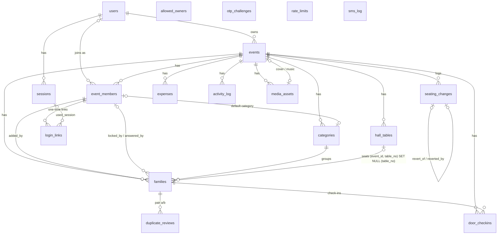

# Ф2 · Фундамент: база, вход, доступ — пакет сдачи (локальная часть)

Версия 1.0 · 2026-10-10 · full-stack разработчик (агент) → архитектор
Бриф: `docs/phases/Ф2-brief.md` (с дополнениями по ревью Ф0). План: `architecture/ARCHITECTURE_PLAN.md` v1.4, разделы 5, 6.1, 9, 11.2–11.5.

**Статус:** сделана вся локальная часть. Всё, что требует аккаунтов (GitHub, Vercel, Neon, SMSC/Mobizon, реальные телефоны), подготовлено и перечислено в разделе 10 «Ожидает основателя». Как и в Ф0, локально база — PGlite (Postgres-совместимая), настоящий `postgres:16` будет в CI.

---

## 1. Ссылки

| Что | Где |
|---|---|
| Ветка | `phase/F2-foundation` от `phase/F7a-seating` (коммит `53cc78a`; этот handover — следующий коммит). Remote нет — ждёт GitHub |
| PR / preview / прод | ожидает основателя |
| Демо-вход локально | `pnpm db:local --memory` → `pnpm db:migrate` → `pnpm db:seed --links` (ссылки для Әкесі/Анасы/Жастар) или `/login` с номером `+7 700 000 00 01…03` — код показывается на экране при `SMS_PROVIDER=console` |

## 2. Что сделано (чек-лист брифа)

- [x] **Схема Drizzle целиком по разделу 5** — `src/server/schema.ts`, 18 таблиц, 10 enum. Входят `login_links`, `allowed_owners`, `member_kind`, `can_manage_budget`, `updated_by`. Число мест 1–20 (CHECK). Миграции:
  - `0001_schema.sql` — сгенерирована `drizzle-kit`;
  - `0002_pg15_constraints.sql` — вручную то, что Drizzle не умеет:
    - `FOREIGN KEY (event_id, table_no) … ON DELETE SET NULL (table_no)` (PG15+);
    - `UNIQUE (event_id, seating_rank) DEFERRABLE INITIALLY DEFERRED`.
  - Все миграции только расширяющие и накатываются с нуля (integration-тесты и e2e делают это каждый прогон).
- [x] **`deploy-prod.yml`**: check:messages → `drizzle-kit migrate` против прода → `vercel pull/build --prod` → `vercel deploy --prebuilt --prod`.
  - Автодеплой `main` выключен в `vercel.json` (`git.deploymentEnabled.main = false`).
  - Preview: `scripts/vercel-build.mjs` перед сборкой накатывает миграции на ветку Neon этого PR.
  - Секреты GitHub вносит основатель (раздел 10).
- [x] **Вход по ссылке (поток 1).**
  - `issueMemberLink`: 22 символа base62, в базе только sha256, 72 ч, новая ссылка отзывает старые, 20 в сутки на событие; текст `wa.memberLogin` из `content/messages`.
  - `GET /join/{token}` — только чтение (`inspectLink`).
  - `POST` = Server Action `consumeLoginLinkAction` → атомарный `update … returning`; 10 неудач в час на IP.
  - Экран «Сілтеме жарамсыз»: кнопки «Иесінен сұрау» (`wa.me` хозяина с `wa.requestLink`) и «SMS-кодпен кіру».
  - Действия хозяина: `issueLoginLinkAction(memberId)` и `revokeMemberSessionsAction` (`requireOwner`).
- [x] **Поток 4:** `allowed_owners` и `pnpm admin:owner-link +7…` (ссылка `owner_bootstrap`, старые отзываются).
- [x] **Вход по SMS (потоки 2–3).**
  - `requestOtp`: одинаковый ответ `{ok, challengeId, retryAfterSec}` для любого номера; SMS — только известным (`event_members` живого события или `allowed_owners`).
  - Только `+7 7XX` (Н4).
  - Лимиты в `rate_limits`: 1/60 с, 5/ч, 10/сут на номер; 20/ч на IP; глобальный `SMS_DAILY_LIMIT`.
  - `otpDeliveryStatus(challengeId)` берёт телефон для `status(id, to)` из `otp_challenges`. Клиент опрашивает через 20 с.
  - `verifyOtp`: 6 цифр, HMAC-SHA256 с `OTP_HMAC_SECRET`, сравнение за постоянное время, 5 минут, 5 попыток, после 5 неудач новый код не раньше чем через 10 минут.
  - Кнопка `auth.code.resend` — повтор через `SMS_FALLBACK_PROVIDER`; «Той иесінен сілтеме сұрау» открывает `wa.me`.
  - `sms_log` хранит только маску и sha256 номера.
- [x] **Сессии.**
  - Cookie `toi_session`: `HttpOnly; Secure; SameSite=Lax; Path=/`.
  - 180 дней; скользящее продление не чаще раза в сутки; не больше 3 активных сессий (4-я отзывает самую старую).
  - `device_label` из User-Agent («Android · Chrome»); `logout`; отзыв всех сессий составителя.
  - `src/proxy.ts` (в Next 16 это бывший middleware) для `/e/*`: без cookie — на `/login`.
- [x] **`authz`.**
  - `src/server/authz.ts`: `requireUser`, `requireMember(eventId, {seating})`, `requireBudget`, `requireOwner`, `guestByToken`, `doorByToken`.
  - Ядро без `next/headers` — `src/server/auth/access.ts` (тестируется напрямую).
  - Матрица и тесты на 403 — раздел 6.
- [x] **Язык пользователя:** `users.locale` обновляется при каждом входе по cookie `locale`. SMS идёт на языке интерфейса в момент запроса (CONTENT_REVIEW 6.8).
- [x] **Сиды** (`scripts/lib/seed-sample.ts`, данные из `tests/fixtures/sample-event.ts`):
  - «Айбек пен Дана»: 3 составителя с правами по типу, 8 категорий (подписи из `content/messages` `category.names.*`), 65 семей, зал 4 × 16 × 12;
  - рассадка = полная пересадка движка Ф7a (совпадает с золотой колонкой), закрепления на 7 и 12, история h1–h6;
  - демо-номера `+7700000000X`; запуск при `VERCEL_ENV=production` запрещён;
  - отдельно `pnpm db:seed-empty`.
- [ ] **Реальные телефоны** (WhatsApp → Android Chrome / iOS Safari, подсказки `auth.install.*`) — **ожидает основателя** (нужен деплой; раздел 10).
- [x] **Н3:** при `VERCEL_ENV=production` нужен явный `APP_URL` (без запасного варианта из `VERCEL_URL`), а `SMS_PROVIDER=console` даёт ошибку при старте.
- [x] **Н4:** `isKzMobile` в `src/domain/guests/phone.ts`; `normalizePhone` общая.
- [x] **Н5:** проверка `db: "ok"` и e2e входа пропускаются только локально. В CI отсутствие `DATABASE_URL` — ошибка: global setup e2e падает, `test.skip(… && !CI)`.
- [x] **Н6:** e2e идут против standalone-сервера: `scripts/start-standalone.mjs` копирует `static` и `public` и запускает `server.js` (`pnpm start:standalone`). `next start` больше не используется.

Экраны `/join`, `/login`, `/e`, `/e/[eventId]` — временные, нейтральные стили. Все тексты из `content/messages`.

## 3. Изменённые файлы

`git diff --stat phase/F7a-seating...53cc78a`: **56 files changed, 8799 insertions(+), 36 deletions(-)**. Из них ~5 000 строк — snapshot-файлы drizzle и lockfile.

```
db/migrations/0001_schema.sql (337), 0002_pg15_constraints.sql (8), meta/*
src/server/schema.ts, db.ts, env.ts, crypto.ts, ratelimit.ts, categories.ts, authz.ts
src/server/auth/{access,session,loginLinks,otp,device}.ts   src/server/actions/auth.ts
src/app/(auth)/join/[token]/page.tsx  src/app/(auth)/login/{page,LoginForm}.tsx  src/app/e/{page,[eventId]/page}.tsx
src/proxy.ts  src/i18n/messages.ts  src/domain/guests/phone.ts (isKzMobile)
scripts/{seed,seed-empty,admin-owner-link,db-local}.ts  scripts/{start-standalone,vercel-build}.mjs
scripts/lib/{seed-sample,pglite-server,migrate,cli-env}.ts
tests/integration/{global-setup,helpers}.ts + 4 test files; tests/unit/auth-units.test.ts
tests/e2e/{auth.spec,global-setup}.ts, smoke.spec.ts (Н5)
.github/workflows/ci.yml (integration step), deploy-prod.yml; vercel.json; playwright.config.ts; vitest.config.ts (projects)
```

**Новые зависимости (dev):**
- `@electric-sql/pglite` 0.5.8 и `@electric-sql/pglite-socket` 0.2.11 — локальная Postgres-совместимая база без Docker. Используется в `pnpm db:local`, integration-тестах и локальных e2e. В рантайм приложения не попадают.

**Новые переменные окружения:** нет. Читаются системные `VERCEL_ENV` и `TEST_DATABASE_URL` (только тесты/CI).

**Новые скрипты:**
- `test:integration`, `test:all`;
- `db:local`, `db:seed`, `db:seed-empty`;
- `admin:owner-link`, `start:standalone`.

`pnpm test` теперь запускает только unit-проект.

## 4. Миграции

| Файл | Что | Тип |
|---|---|---|
| `0000_init.sql` (Ф0) | `create extension if not exists pgcrypto` | расширяющая |
| `0001_schema.sql` | 18 таблиц, 10 enum, CHECK, частичные уникальные индексы, FK | расширяющая (новые объекты) |
| `0002_pg15_constraints.sql` | пересоздание `families_event_table_fk` с `ON DELETE SET NULL (table_no)`; `categories_event_rank_key` DEFERRABLE | расширяющая (таблицы новые, данных нет) |

Накат с нуля:
- локально — `pnpm db:migrate` (drizzle-kit) и программно (`migrateUrl`, integration и e2e global setup) на PGlite;
- после наката — сид на копии фикстуры (`schema-seed.test.ts`).

Поведение FK `SET NULL (table_no)` проверено тестом: удаление стола 15 → `table_no = null`, `event_id` сохранён.

## 5. Тесты — реальный вывод

### 5.1 Сводка
```
$ pnpm check:messages
check:messages: OK — 757 keys, kk/ru: ICU, variables, tags, select/other, ru plural forms
$ pnpm typecheck
✓ Types generated successfully
$ pnpm lint
$ eslint --max-warnings=0
$ pnpm format:check
All matched files use Prettier code style!
$ pnpm test                       (unit)
 Test Files  16 passed (16)
      Tests  143 passed (143)
$ pnpm test:integration           (PGlite, миграции с нуля)
[integration] PGlite on port … (set TEST_DATABASE_URL to use real Postgres)
 Test Files  4 passed (4)
      Tests  39 passed (39)
$ pnpm build
✓ Compiled successfully
Route (app)  ƒ /  ƒ /api/health  ƒ /e  ƒ /e/[eventId]  ƒ /join/[token]  ƒ /login   ƒ Proxy (Middleware)
$ E2E_CHANNEL=chrome DATABASE_URL=postgres://…@127.0.0.1:5434/… pnpm test:e2e   (standalone server, PGlite)
  24 passed (38.1s)
$ gitleaks protect --staged
INF no leaks found
```

### 5.2 Integration (39)
- **`schema-seed`, 8:** сид (составители, права, категории, 16 столов, h1–h6); столы = золотая колонка Ф7a; повторный сид идемпотентен; seed-empty; CHECK 1–20, `yes` ⇒ confirmed, закрепление ⇒ стол; FK `SET NULL (table_no)`; DEFERRABLE ранги (обмен в транзакции); формат телефона, один хозяин, уникальный телефон гостя; `pgcrypto`.
- **`login-links`, 10:**
  - токен и хэш, 72 ч, `wa.me`;
  - GET три раза ничего не тратит, POST один раз, повтор отклоняется;
  - пользователь и сессия, `device_label`, `used_session_id`;
  - истечение после 72 ч и отзыв новой ссылкой;
  - экран «жарамсыз» с телефоном хозяина;
  - удалённый составитель;
  - 10 неудач в час на IP;
  - 20 ссылок в сутки;
  - `owner_bootstrap`: вход и потеря доступа при удалении из `allowed_owners`, при этом неудачная попытка не сжигает ссылку.
- **`otp-sessions`, 14:**
  - одинаковый ответ, SMS только известному номеру, в `sms_log` маска без полного номера;
  - текст `sms.otp` на `ru` с доменом;
  - неполный номер и не мобильный;
  - лимиты 60 с / час / сутки (и для неизвестных номеров), 20/ч на IP, глобальный лимит;
  - верный код → сессия `sms`, `users.locale`, членство; повтор кода не проходит;
  - 5 попыток → блокировка, новый код через 10 минут; истечение через 5 минут; неизвестный номер никогда не проходит проверку;
  - `otpDeliveryStatus`;
  - сессии: 180 дней и продление раз в сутки, максимум 3, logout и отзыв всех.
- **`authz`, 7:** матрица 4 функции × 4 роли; три сценария приёмки; выдача права; удалённый составитель, удалённое событие, мусорный id → 403; права по типу; `guestByToken`, `doorByToken`.

Покрытие integration (`src/server/auth/**`, `ratelimit.ts`, `crypto.ts`): **строки 95,7 %**, ветки 84 %.

### 5.3 e2e (Playwright, `mobile` 360×740 и `desktop` 1440×900, standalone-сервер) — 24 passed
- Смоук Ф0 (5 × 2), включая `/api/health` → `db: "ok"`.
- Вход по ссылке:
  - GET и перезагрузка не тратят ссылку, «Кіру» → `/e`, повторное открытие → «Сілтеме жарамсыз»;
  - заменённая (отозванная) ссылка → экран «жарамсыз» → «SMS-кодпен кіру» ведёт на `/login`;
  - мусорный токен → «жарамсыз».
- Вход по коду: телефон → код консольного провайдера на экране → `/e/{eventId}` демо-события; немобильный номер → текст `auth.login.errors.phoneNotMobile`.
- Доступ: `/e` без сессии → `/login` (proxy); вошедший чужой человек на `/e/{eventId}` → 404.

Первый повторный прогон упал: тест получил `auth.login.errors.tooSoon` — лимит 60 с от предыдущего прогона в той же базе. Так подтвердилось, что лимит работает end-to-end. Глобальная настройка e2e теперь очищает `rate_limits` и `otp_challenges` своей тестовой базы.

### 5.4 Логи
Все `console.*` в `src/server`:
- `otp.ts` — три сообщения без номеров (лимит, провайдер не настроен, ошибка провайдера; тексты ошибок провайдеров без ключей и номеров — тесты Ф0);
- `sms/console.ts` — маска номера + текст SMS; только для `console`, который на продакшене запрещён (Н3).

Секреты не логируются: env печатает только имена переменных.

## 6. Матрица доступа (план 5.3) — проверена `tests/integration/authz.test.ts`

| Функция `authz` | Действия (план 6.2–6.7) | Хозяин | Родитель (Әкесі/Анасы, `parent`) | Жастар (`couple`, «Тек тізім») | Чужой |
|---|---|---|---|---|---|
| `requireUser` | список событий, создание события (+ `allowed_owners`) | ✓ | ✓ | ✓ | ✓ (только свои) |
| `requireMember` | гости, итоги, просмотр зала, `version` | ✓ | ✓ | ✓ | **403** |
| `requireMember({seating})` | перенос, порядок, зал, полная пересадка, `seatUnplaced`, отмена | ✓ | ✓ | **403** (если хозяин не выдал право) | **403** |
| `requireBudget` | расходы, бюджет | ✓ | ✓ (Р9) | **403** | **403** |
| `requireOwner` | настройки, составители, права, ссылки входа, отзыв сессий, ссылка помощника, удаление | ✓ | **403** | **403** | **403** |
| `guestByToken` | страница гостя, ответ | по токену семьи; удалённая семья или событие → 404 | | | |
| `doorByToken` | помощник на входе | по `door_token`; удалённое событие → 404 | | | |

Удалённый составитель (`removed_at`) и удалённое событие дают 403 всем. Несуществующий id события тоже даёт 403 — по ответу нельзя узнать, существует ли событие.

## 7. ER-схема


`allowed_owners`, `otp_challenges`, `rate_limits` и `sms_log` намеренно без внешних ключей: они работают по телефону или ключу, до появления пользователя.

## 8. Критерии приёмки

| Критерий брифа | Статус | Как проверено |
|---|---|---|
| e2e «вход по ссылке» и «вход по коду» (`console`) зелёные | **выполнен локально** (PGlite, standalone) | 5.3; в CI — на `postgres:16` после появления GitHub |
| повторное использование ссылки отклоняется | **выполнен** | e2e + integration |
| GET без «Кіру» ссылку не тратит | **выполнен** | e2e (переход и перезагрузка) + integration (3 GET) |
| просроченная ссылка → «ескірген» | **выполнен** | integration: истечение 72 ч через подставленное время; e2e: отозванная и мусорная ссылки (часы сервера в e2e не сдвинуть) |
| лимиты OTP покрыты тестами; неизвестный номер — тот же ответ, SMS не уходит (по `sms_log`) | **выполнен** | 5.2 `otp-sessions` |
| 403-матрица: «Тек тізім» → рассадка, «Жастар» → расходы, чужой → событие | **выполнен** | 6 + e2e «чужой → 404» |
| Миграции через `deploy-prod.yml`; у preview своя ветка Neon | **подготовлено, ожидает основателя** | workflow и `vercel-build.mjs` в репозитории |
| В логах нет секретов и полных номеров | **выполнен** | 5.4, тесты `sms_log` и консольного вывода |
| ER-схема, матрица `authz` | **сдано** | 7, 6 |
| Реальные телефоны: WhatsApp → Android/iOS | **ожидает основателя** | — |

## 9. Отклонения

1. **Порядок фаз и старт.** Ф2 начата до окончательного «принято» по Ф0 («принято условно — ждёт аккаунтов»), по указанию координатора и разделу 6 ревью Ф7a. Ветка идёт от `phase/F7a-seating`.
2. **`otp_challenges.provider_msg_id`** — новая колонка, в плане 5 её нет. Нужна, чтобы `otpDeliveryStatus(challengeId)` нашёл сообщение у провайдера: полный номер есть только в `otp_challenges`, а в `sms_log` его нет.
3. **Ключи `rate_limits`** содержат sha256 номера и IP вместо сырых значений (в плане пример `otp:phone:+7701…`), чтобы персональные данные не попадали в таблицу лимитов.
4. **Неизвестные номера** тоже получают запись в `otp_challenges` (с `provider = 'none'`), чтобы ответ был одинаковым — включая `challengeId`. Эти записи хранят номер. Очистку старых `otp_challenges` (например, старше 7 дней) нужно добавить в `/api/cron/cleanup` — **предлагаю как задачу Ф11**.
5. **Глобальный лимит SMS исчерпан:** ответ тот же `ok`, SMS не отправляется, в лог пишется предупреждение. Отдельного канала оповещения пока нет — это Sentry (Ф0, ожидает DSN).
6. **Ошибка провайдера** возвращает `sendFailed` только для известного номера. Это единственный случай, когда ответ различается: человек должен узнать, что SMS не ушла. Компромисс осознанный.
7. **Вход по ссылке и по SMS привязывает все членства с этим телефоном**, а не только событие из ссылки. Ссылка доказывает владение номером так же, как SMS.
8. **«Иесінен сұрау» на `/login`** открывает `wa.me/?text=…` без номера (WhatsApp предложит выбрать контакт): на `/login` хозяин неизвестен, а раскрывать его номер по введённому телефону нельзя.
9. **`isKzMobile` — по правилу Н4** («национальная часть начинается с 7»). Казахстанские стационарные номера (`+7 7172…`, `+7 727…`) тоже начинаются с 7 и проходят проверку; SMS на них просто не дойдёт. Точный список мобильных кодов можно ввести позже.
10. **Повтор через запасной провайдер:** если `SMS_FALLBACK_PROVIDER` не задан, повтор идёт через основной.
11. **e2e «просроченная ссылка»** проверяет отозванную (заменённую) и мусорную ссылки. Настоящее истечение 72 ч проверено в integration через подставленное время: часы standalone-сервера в e2e не сдвинуть.
12. **e2e входа по ссылке** использует ссылку хозяина (`admin:owner-link`, поток 4). Ссылка составителя (поток 1, с меткой «Анасы» и событием) проверена в integration. Для ручной проверки: `pnpm db:seed --links`.
13. **Локальная база — PGlite** (новые dev-зависимости, `pnpm db:local`). Это не Postgres 16, но схема с PG15+ FK и DEFERRABLE на нём работает. Окончательная проверка — `postgres:16` в CI.
14. **JSON-импорт с атрибутом** `with { type: "json" }` в `src/i18n/messages.ts`. Без него ESM-загрузчик Playwright не импортирует сиды.
15. **`vercel.json`:** `git.deploymentEnabled.main = false` и `buildCommand: node scripts/vercel-build.mjs` (миграции для preview). Vercel CLI в `deploy-prod.yml` закреплён на 63.1.0 (последняя стабильная на сегодня по `npm view`).
16. **Proxy** проверяет только наличие cookie (без базы); настоящая проверка — `requireUser`/`requireMember` на каждой странице и в каждом действии.
17. **Временные страницы** `/e` (список тоев, «Шығу») и `/e/[eventId]` (название события и роль). «Менің тізімім» — Ф4. Подсказка `auth.install.*` не сделана: нужны заметки с реальных телефонов, а экран — в Ф1.
18. **Сид.**
    - Хозяин демо-события — Әкесі (`role = owner`); в плане не указано, кто именно.
    - Пустое событие — номер `+77000000009`.
    - `summary` истории записан в рабочем формате (`names`, `from`, `to`); окончательный формат — вместе с текстами истории в Ф7b.
19. **`pnpm test` = только unit**; integration — отдельной командой (`test:integration`), в CI — отдельным шагом на `postgres:16`. `test:coverage` в CI ограничен unit-проектом.
20. **Cookie `Secure` на `http://localhost`** работает в Chrome (исключение для localhost). Safari может такую cookie не сохранить. Для локальной разработки в Safari нужен https; на Vercel всегда https.
21. **Server Actions входа** (`requestOtpAction`, `verifyOtpAction`, `consumeLoginLinkAction`) — публичные, `authz` им не нужен; zod-валидация есть.

## 10. Ожидает основателя (дополнение к handover после аккаунтов)

| Шаг | Что сделать | Что проверит разработчик |
|---|---|---|
| GitHub | шаг 1 чек-листа Ф0 | первый CI: unit, **integration на `postgres:16`**, e2e на `postgres:16`, Docker, gitleaks |
| Vercel | шаг 2 Ф0. **Важно:** при `vercel.json` с `git.deploymentEnabled.main = false` прод деплоит только `deploy-prod.yml`. Добавить `ENABLE_EXPERIMENTAL_COREPACK=1` (Н1 ревью Ф0) | preview на PR |
| Neon | шаг 3 Ф0 + ветки для Preview | `vercel-build.mjs` накатывает миграции на ветку PR; `/api/health` → `db: "ok"` (драйвер `neon`, Н2) |
| GitHub Secrets для `deploy-prod.yml` | `VERCEL_TOKEN`, `VERCEL_ORG_ID`, `VERCEL_PROJECT_ID` (из `.vercel/project.json` после `vercel link`), `PROD_DATABASE_URL_UNPOOLED` (direct-строка прода); environment `production` | первый деплой через workflow: миграции → прод |
| Пилотный хозяин | `pnpm admin:owner-link +7…` с env прода на своей машине | — |
| Реальные телефоны | Android (WhatsApp → Chrome) и iPhone (WhatsApp → Safari): открыть ссылку составителя, «Кіру», закрыть и открыть снова — вход должен сохраниться. Ярлык на главном экране (Android) и закладка (iOS) | скриншоты и заметки о встроенных браузерах для `auth.install.*` |
| SMS | ключи SMSC/Mobizon (Ф0) | реальный `requestOtp` → `otpDeliveryStatus` → `verifyOtp`; `sms_log` |

Команды основателя после аккаунтов:
```
git remote add origin https://github.com/<user>/toi.git
git push -u origin main phase/F0-setup phase/F7a-seating phase/F2-foundation
# локально после ветки Neon dev в .env.local:
pnpm db:migrate && pnpm db:seed --links && pnpm dev
# хозяин пилота (env прода):
pnpm admin:owner-link +77XXXXXXXXX --note "семья-пилот"
```

## 11. Самопроверка (13.6)

- [x] Задачи брифа выполнены, кроме требующих аккаунтов (раздел 10).
- [ ] Проверка на preview URL — ожидает Vercel.
- [x] Отклонения записаны (раздел 9).
- [x] `src/domain` чистый: правило границ, `isKzMobile` без импортов.
- [x] Каждое действие начинается с `authz` (кроме публичных действий входа) и zod-валидации; route handlers без входных данных.
- [x] Нет запрещённого по 4.4: обычный Postgres, rate limit в Postgres, без Vercel KV/Edge. Proxy работает в Node.js runtime (по умолчанию в Next 16).
- [x] Тексты только из `content/messages` (включая `wa.*`, `sms.otp`, `category.names.*`).
- [x] Миграции расширяющие, накатываются с нуля.
- [x] Токены случайные; в базе хэши (сессии, ссылки, коды); лимиты на месте; cookie с правильными флагами; одинаковый ответ `requestOtp`.
- [x] Персональные данные не попадают в логи и в `sms_log`; Sentry чистит события (Ф0).
- [x] `dangerouslySetInnerHTML` нет.
- [x] unit 143, integration 39, e2e 24 — зелёные.

---

## 12. Правки по ревью (`docs/phases/Ф2-review.md`, вердикт «нужны правки»)

Перед правками вся цепочка перебазирована на `main` (`887cdb3`, ревью и план v1.5): `phase/F0-setup` → `phase/F7a-seating` → `phase/F2-foundation`, все три — `Successfully rebased`.

Коммит **`1a13633` `fix(F2): review Б1–Б3 …`**:
```
$ git diff --stat 1a13633~1 1a13633   (без snapshot-файлов drizzle)
 .github/workflows/deploy-prod.yml       |   13 +
 db/migrations/0003_session_scope.sql    |   10 +   (новая, расширяющая)
 src/app/api/cron/cleanup/route.ts       |   22 +   (новый)
 src/app/e/page.tsx                      |   14 +-
 src/server/actions/auth.ts              |   15 +-
 src/server/auth/access.ts               |   19 +-
 src/server/auth/loginLinks.ts           |   79 +-
 src/server/auth/otp.ts                  |   35 +-
 src/server/auth/session.ts              |  174 +++-
 src/server/authz.ts                     |    6 +-
 src/server/cleanup.ts                   |   41 +   (новый)
 src/server/schema.ts                    |   25 +-
 tests/e2e/auth.spec.ts, tests/e2e/global-setup.ts
 tests/integration/session-scope.test.ts |  223 +++++  (новый)
 tests/integration/cleanup.test.ts       |  106 +++  (новый)
 tests/integration/authz.test.ts, otp-sessions.test.ts (новые сигнатуры)
 vercel.json                             |    8 +-   (crons)
```

| № | Что сделано | Где | Тесты |
|---|---|---|---|
| **Б1** | `sessions.scope` (`'all'` \| `'events'`, CHECK) и таблица `session_events` — миграция `0003_session_scope.sql`, только расширяющая. Внешний ключ из `0002` не трогается. | `schema.ts`, `0003` | — |
| | Ссылка составителя: привязывается **только** членство из ссылки; сессия `scope = 'events'` с этим событием. Если на устройстве уже есть сессия того же человека со `scope = 'events'` (cookie `toi_session`), событие добавляется в неё. Cookie другого человека не используется. | `loginLinks.ts` (`consumeLink`), `session.ts` (`addEventToSession`) | «две ссылки разных событий на одном устройстве → одна сессия с двумя событиями»; «cookie другого человека → новая сессия» |
| | SMS и ссылка основателя (`owner_bootstrap`) → `scope = 'all'`, привязываются все членства телефона. | `otp.ts`, `loginLinks.ts` | «SMS → доступ к A и B»; «owner_bootstrap → 'all'» |
| | `authorize` принимает `Principal {userId, scope, sessionId}`: при `'events'` событие должно быть в `session_events`. `requireUser` возвращает `scope` и `sessionId`. | `access.ts`, `authz.ts` | **«хозяин A открыл ссылку P → в B 403»**, в двух вариантах: P ещё не входил в B; P уже работает в B со своего телефона (тот же `users.id`) |
| | `/e` для `'events'` показывает только события сессии. | `src/app/e/page.tsx` (`sessionEventIds`) | e2e «ссылка составителя → «Мои тои» содержит только его событие» |
| | «Шығару» (`revokeMemberEventAccess`): событие убирается из `session_events` сессий этого человека, сессии без событий отзываются; сессии `'all'` не трогаются. | `session.ts`, `actions/auth.ts` | «Шығару в A не трогает SMS-сессию P» |
| | Лимит 3 сессий считается отдельно: для `'all'` — на человека, для `'events'` — на событие (старейшая теряет событие). | `session.ts` (`createSession`, `enforceEventCap`) | «4 ссылки → старейшая ссылочная сессия отозвана, SMS-сессия жива; 3 новых SMS → уходит старая SMS, ссылочные живы» |
| | Вход по ссылке не меняет `users.locale` существующего пользователя (у нового пользователя язык ставится); SMS обновляет язык. | `session.ts` (`upsertUser({updateLocale})`) | «ссылка не меняет язык; SMS меняет» |
| **Б2** | `verifyOtp` не принимает проверку с `provider = 'none'`: ответ как на неверный код, попытки считаются. | `otp.ts` | в проверку неизвестного номера подложен известный код → `{error: "wrong", left: 4}`, ни пользователя, ни сессии |
| **Б3** | `/api/cron/cleanup`: `Authorization: Bearer CRON_SECRET` (хэши сравниваются за постоянное время), ответ — только счётчики. Vercel Cron раз в сутки в 22:00 UTC (03:00 Алматы). Удаляет: `otp_challenges` старше 24 ч; `rate_limits` старше 2 суток; `login_links` использованные, отозванные или истёкшие больше 30 дней назад; `sessions` отозванные или истёкшие больше 30 дней назад; `session_events` — каскадом. | `cleanup.ts`, `route.ts`, `vercel.json` | по каждой таблице: удаляется только старое, свежее остаётся; каскад `session_events`; 401 без заголовка, с неверным секретом и без `Bearer `; 200 только со счётчиками |
| **Н13** | Комментарий у `families_event_table_fk`: ограничение задано вручную в `0002`, Drizzle его не пересоздаёт; регрессию ловит тест. | `schema.ts` | `schema-seed` (`SET NULL (table_no)`) |
| **Н7** | Ключи `rate_limits` и `sms_log.phone_hash` — HMAC с серверным секретом (`OTP_HMAC_SECRET`, отдельная метка назначения) вместо голого sha256. | `otp.ts` (`keyedHash`) | существующие тесты лимитов и `sms_log` |
| **Н11** | `deploy-prod.yml`: `paths-ignore` для `docs/**`, `architecture/**`, `design/**`, `research/**`, `prototype/**`, корневых `*.md`, `content/*.md`. `content/messages/**` **не** игнорируется. | `deploy-prod.yml` | — (сработает на GitHub) |

**Найдено при прогоне e2e:** после SMS-входа переход открывал событие, только если членство было привязано именно сейчас. Если человек уже входил в это событие по ссылке, его отправляло на `/e`. Теперь правило такое: у человека ровно одно событие → открываем его, иначе «Менің тойларым».

**Проверка, что тесты Б1 и Б2 ловят ошибки** (мутации, после проверки откачены):
- выключил проверку scope в `authorize` → первый вариант теста (P ещё не входил в B) **не упал**: членство P в B не было привязано, и 403 получалось и без scope. Поэтому добавлен второй вариант «P уже работает в B»; с мутацией он падает;
- убрал условие `provider !== "none"` → тест Б2 падает.

**Проверки после правок (реальный вывод):**
```
$ pnpm check:messages
check:messages: OK — 757 keys, kk/ru: ICU, variables, tags, select/other, ru plural forms
$ pnpm typecheck
✓ Types generated successfully
$ pnpm lint
$ eslint --max-warnings=0
$ pnpm format:check
All matched files use Prettier code style!
$ pnpm test
 Test Files  16 passed (16)
      Tests  143 passed (143)
$ pnpm test:integration          (PGlite, миграции 0000–0003 с нуля)
 Test Files  6 passed (6)
      Tests  51 passed (51)
$ pnpm build
✓ Compiled successfully   … ├ ƒ /api/cron/cleanup
$ E2E_CHANNEL=chrome DATABASE_URL=postgres://…@127.0.0.1:5435/… pnpm test:e2e   (standalone, PGlite)
  26 passed (45.8s)
$ gitleaks protect --staged
INF no leaks found
```

**Известное, не исправлялось в этом круге** (по ревью, раздел 5):
- Н8: разница во времени ответа `requestOtp` для известного и неизвестного номера — до коммерческого запуска;
- Н9: IP из `x-forwarded-for` за прокси в KZ — Ф12;
- Н10: `APP_ENV=production` для KZ — Ф12;
- Н12: на первом preview проверить, что Neon отдаёт `DATABASE_URL_UNPOOLED` на этапе сборки;
- точный список мобильных кодов (отклонение 9) — до коммерческого запуска.

**Новое отклонение:** секрет HMAC для ключей лимитов и `sms_log` — `OTP_HMAC_SECRET` (с меткой назначения), а не отдельная переменная. Если этот секрет сменить, старые записи `sms_log` перестанут находиться по номеру; для журнала это допустимо.
